# Page planner screenshots

[Back to the report](README.md)

The page planner turns fixtures into Virtual Console pages. Full window grabs from `pageplanner_test`.

Click a thumbnail for the full-size image.

## Reference pages, one fixture each (`referencePage`)

The page the planner builds for one fixture. Under each image: the planned page as text.

<table>
<tr><td align="center" valign="top"><a href="images/page-planner/01-generic-rgb.png">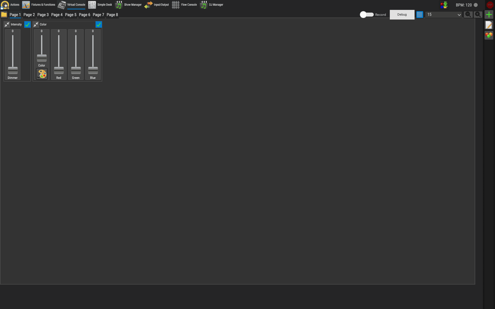</a> 01: Generic RGB, RGB Dimmer

Planned page (text)
<pre># Generic RGB 1
## Intensity
- Dimmer [Intensity/Dimmer, Fader, 1 ch, 0 heads, 0 choices]
## Color
- Color [Color, ColorMixer, 3 ch, 0 heads, 0 choices]
- Red [Color/Red, Fader, 1 ch, 0 heads, 0 choices]
- Green [Color/Green, Fader, 1 ch, 0 heads, 0 choices]
- Blue [Color/Blue, Fader, 1 ch, 0 heads, 0 choices]</pre>

</td><td align="center" valign="top"> 02: American DJ Mega Flat TRI PAK Plus, 6 Channel

Planned page (text)
<pre># Mega Flat TRI PAK Plus 1
## Intensity
- Shutter/Strobe [Shutter#1/buttons, Presets, 0 ch, 0 heads, 5 choices]
- Shutter/Strobe speed [Shutter#1/rate, Fader, 1 ch, 0 heads, 0 choices]
- Master dimmer [Intensity/Dimmer, Fader, 1 ch, 0 heads, 0 choices]
## Color
- Color [Color, ColorMixer, 4 ch, 0 heads, 0 choices]
- Red [Color/Red, Fader, 1 ch, 0 heads, 0 choices]
- Green [Color/Green, Fader, 1 ch, 0 heads, 0 choices]
- Blue [Color/Blue, Fader, 1 ch, 0 heads, 0 choices]
- UV [Color/UV, Fader, 1 ch, 0 heads, 0 choices]</pre>

</td></tr>
<tr><td align="center" valign="top"> 03: AVE StagePar Hex18, 10 Channel

Planned page (text)
<pre># StagePar Hex18 1
## Intensity
- Dimming [Intensity/Dimmer, Fader, 1 ch, 0 heads, 0 choices]
- Strobe [Shutter#1/buttons, Presets, 0 ch, 0 heads, 2 choices]
- Strobe speed [Shutter#1/rate, Fader, 1 ch, 0 heads, 0 choices]
## Color
- Color [Color, ColorMixer, 6 ch, 0 heads, 0 choices]
- Red [Color/Red, Fader, 1 ch, 0 heads, 0 choices]
- Green [Color/Green, Fader, 1 ch, 0 heads, 0 choices]
- Blue [Color/Blue, Fader, 1 ch, 0 heads, 0 choices]
- White [Color/White, Fader, 1 ch, 0 heads, 0 choices]
- Amber [Color/Amber, Fader, 1 ch, 0 heads, 0 choices]
- UV [Color/UV, Fader, 1 ch, 0 heads, 0 choices]
## Effects
- Functions [Effect/functions, Presets, 1 ch, 0 heads, 0 choices]
- Auto/Sound speed [Speed/auto/sound speed, Fader, 1 ch, 0 heads, 0 choices]</pre>

</td><td align="center" valign="top"> 04: Chauvet Intimidator Beam 140SR V2, 14 Channel

Planned page (text)
<pre># Intimidator Beam 140SR V2 1
## Intensity
- Dimmer [Intensity/Dimmer, Fader, 1 ch, 0 heads, 0 choices]
- Shutter [Shutter#1/buttons, Presets, 0 ch, 0 heads, 7 choices]
- Shutter speed [Shutter#1/rate, Fader, 1 ch, 0 heads, 0 choices]
## Position
- Position [Position, PanTilt, 4 ch, 1 heads, 0 choices]
- Pan/Tilt Speed [Speed/SpeedPanTilt, Fader, 1 ch, 0 heads, 0 choices]
## Color
- Color Wheel [Colour#1/buttons, Presets, 0 ch, 0 heads, 15 choices]
- Color Wheel presets [Colour#1, Presets, 1 ch, 0 heads, 0 choices]
## Gobo
- Gobo Wheel [Gobo#1/buttons, Presets, 0 ch, 0 heads, 18 choices]
- Gobo Wheel presets [Gobo#1, Presets, 1 ch, 0 heads, 0 choices]
## Beam
- Prism [Prism#1/buttons, Presets, 0 ch, 0 heads, 4 choices]
- Prism speed [Prism#1/rate, Fader, 1 ch, 0 heads, 0 choices]
- Focus [Beam/BeamFocus, Fader, 1 ch, 0 heads, 0 choices]
## Effects
- Frost [Effect/frost, Fader, 1 ch, 0 heads, 0 choices]
## Setup
- Function [Maintenance/function, Presets, 1 ch, 0 heads, 0 choices]
- Movement Macros [Maintenance/movement macros, Presets, 1 ch, 0 heads, 0 choices]</pre>

</td></tr>
<tr><td align="center" valign="top"><a href="images/page-planner/05-profile.png">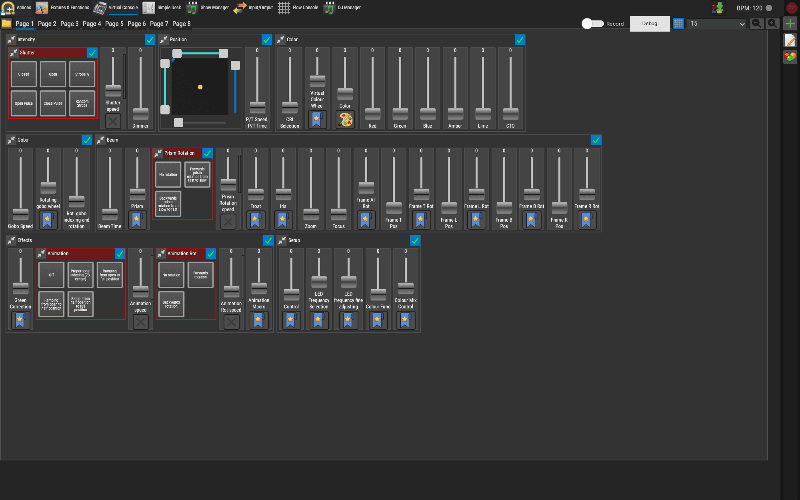</a> 05: Robe Robin T1 Profile, mode 3

Planned page (text)
<pre># Robin T1 Profile 1
## Intensity
- Shutter [Shutter#1/buttons, Presets, 0 ch, 0 heads, 6 choices]
- Shutter speed [Shutter#1/rate, Fader, 1 ch, 0 heads, 0 choices]
- Dimmer [Intensity/Dimmer, Fader, 2 ch, 0 heads, 0 choices]
## Position
- Position [Position, PanTilt, 4 ch, 1 heads, 0 choices]
- P/T Speed, P/T Time [Speed/p/t speed, p/t time, Fader, 1 ch, 0 heads, 0 choices]
## Color
- CRI Selection [Colour#1, Fader, 1 ch, 0 heads, 0 choices]
- Virtual Colour Wheel [Colour#2, Presets, 1 ch, 0 heads, 0 choices]
- Color [Color, ColorMixer, 10 ch, 0 heads, 0 choices]
- Red [Color/Red, Fader, 2 ch, 0 heads, 0 choices]
- Green [Color/Green, Fader, 2 ch, 0 heads, 0 choices]
- Blue [Color/Blue, Fader, 2 ch, 0 heads, 0 choices]
- Amber [Color/Amber, Fader, 2 ch, 0 heads, 0 choices]
- Lime [Color/Lime, Fader, 2 ch, 0 heads, 0 choices]
- CTO [Colour/ColorCTOMixer, Fader, 1 ch, 0 heads, 0 choices]
## Gobo
- Gobo Speed [Speed/gobo speed, Fader, 1 ch, 0 heads, 0 choices]
- Rotating gobo wheel [Gobo#1, Presets, 1 ch, 0 heads, 0 choices]
- Rot. gobo indexing and rotation [Gobo#2, Fader, 2 ch, 0 heads, 0 choices]
## Beam
- Beam Time [Speed/beam time, Fader, 1 ch, 0 heads, 0 choices]
- Prism [Prism#1, Presets, 1 ch, 0 heads, 0 choices]
- Prism Rotation [Prism#2/buttons, Presets, 0 ch, 0 heads, 3 choices]
- Prism Rotation speed [Prism#2/rate, Fader, 1 ch, 0 heads, 0 choices]
- Frost [Beam/frost, Presets, 1 ch, 0 heads, 0 choices]
- Iris [Beam/iris, Presets, 2 ch, 0 heads, 0 choices]
- Zoom [Beam/zoom, Fader, 2 ch, 0 heads, 0 choices]
- Focus [Beam/focus, Fader, 2 ch, 0 heads, 0 choices]
- Frame All Rot [Beam/frame all rot, Presets, 1 ch, 0 heads, 0 choices]
- Frame T Pos [Beam/frame t pos, Fader, 1 ch, 0 heads, 0 choices]
- Frame T Rot [Beam/frame t rot, Presets, 1 ch, 0 heads, 0 choices]
- Frame L Pos [Beam/frame l pos, Fader, 1 ch, 0 heads, 0 choices]
- Frame L Rot [Beam/frame l rot, Presets, 1 ch, 0 heads, 0 choices]
- Frame B Pos [Beam/frame b pos, Fader, 1 ch, 0 heads, 0 choices]
- Frame B Rot [Beam/frame b rot, Presets, 1 ch, 0 heads, 0 choices]
- Frame R Pos [Beam/frame r pos, Fader, 1 ch, 0 heads, 0 choices]
- Frame R Rot [Beam/frame r rot, Presets, 1 ch, 0 heads, 0 choices]
## Effects
- Green Correction [Effect/green correction, Presets, 1 ch, 0 heads, 0 choices]
- Animation [Effect/animation/buttons, Presets, 0 ch, 0 heads, 5 choices]
- Animation speed [Effect/animation/rate, Fader, 1 ch, 0 heads, 0 choices]
- Animation Rot [Effect/animation rot/buttons, Presets, 0 ch, 0 heads, 3 choices]
- Animation Rot speed [Effect/animation rot/rate, Fader, 1 ch, 0 heads, 0 choices]
- Animation Macro [Effect/animation macro, Presets, 1 ch, 0 heads, 0 choices]
## Setup
- Control [Maintenance/control, Presets, 1 ch, 0 heads, 0 choices]
- LED Frequency Selection [Maintenance/led frequency selection, Presets, 1 ch, 0 heads, 0 choices]
- LED frequency fine adjusting [Maintenance/led frequency fine adjusting, Presets, 1 ch, 0 heads, 0 choices]
- Colour Func [Maintenance/colour func, Presets, 1 ch, 0 heads, 0 choices]
- Colour Mix Control [Maintenance/colour mix control, Presets, 1 ch, 0 heads, 0 choices]</pre>

</td><td align="center" valign="top"> 06: Chauvet Intimidator Wash Zoom 350 IRC, 29-Ch

Planned page (text)
<pre># Intimidator Wash Zoom 350 IRC 1
## Intensity
- Dimmer [Intensity/Dimmer, Fader, 1 ch, 0 heads, 0 choices]
- Shutter [Shutter#1, Presets, 1 ch, 0 heads, 0 choices]
## Position
- Position [Position, PanTilt, 4 ch, 1 heads, 0 choices]
- Speed [Speed/SpeedPanTilt, Fader, 1 ch, 0 heads, 0 choices]
## Color
- Color [Color, ColorMixer, 16 ch, 0 heads, 0 choices]
- Red [Color/Red, Fader, 4 ch, 0 heads, 0 choices]
- Green [Color/Green, Fader, 4 ch, 0 heads, 0 choices]
- Blue [Color/Blue, Fader, 4 ch, 0 heads, 0 choices]
- White [Color/White, Fader, 4 ch, 0 heads, 0 choices]
- Colors [Colour#1, Presets, 1 ch, 0 heads, 0 choices]
## Color per head (strip)
- 1 [Color@0, ColorMixer, 4 ch, 0 heads, 0 choices]
- 2 [Color@1, ColorMixer, 4 ch, 0 heads, 0 choices]
- 3 [Color@2, ColorMixer, 4 ch, 0 heads, 0 choices]
- 4 [Color@3, ColorMixer, 4 ch, 0 heads, 0 choices]
## Beam
- Zoom [Beam/BeamZoom, Fader, 1 ch, 0 heads, 0 choices]
## Effects
- Built-in Control [Effect/built-in control, Presets, 1 ch, 0 heads, 0 choices]
- Buil-in Speed [Speed/buil-in speed, Fader, 1 ch, 0 heads, 0 choices]
- Movement macros [Effect/movement macros, Presets, 1 ch, 0 heads, 0 choices]
## Setup
- Control functions [Maintenance/control functions, Presets, 1 ch, 0 heads, 0 choices]</pre>

</td></tr>
<tr><td align="center" valign="top"><a href="images/page-planner/07-matrix.png">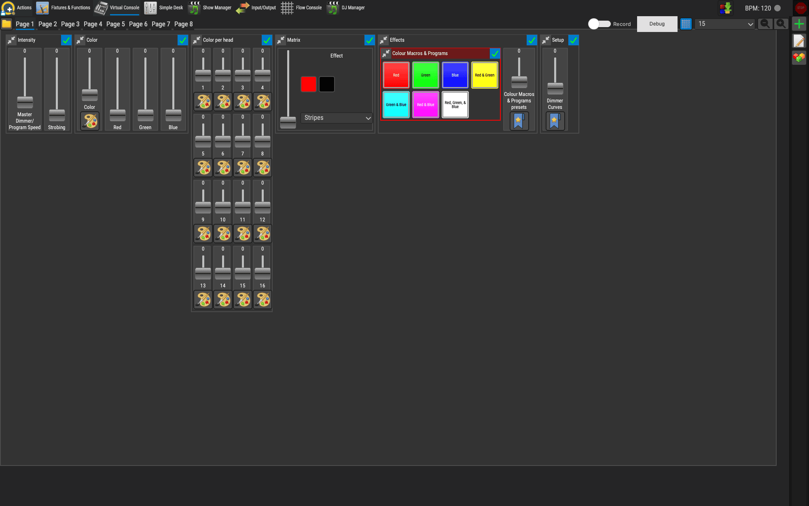</a> 07: American DJ Dotz Matrix, 52 Channel

Planned page (text)
<pre># Dotz Matrix 1
## Intensity
- Master Dimmer/Program Speed [Intensity/Dimmer, Fader, 1 ch, 0 heads, 0 choices]
- Strobing [Shutter/ShutterStrobe, Fader, 1 ch, 0 heads, 0 choices]
## Color
- Color [Color, ColorMixer, 48 ch, 0 heads, 0 choices]
- Red [Color/Red, Fader, 16 ch, 0 heads, 0 choices]
- Green [Color/Green, Fader, 16 ch, 0 heads, 0 choices]
- Blue [Color/Blue, Fader, 16 ch, 0 heads, 0 choices]
## Color per head (strip)
- 1 [Color@0, ColorMixer, 3 ch, 0 heads, 0 choices]
- 2 [Color@1, ColorMixer, 3 ch, 0 heads, 0 choices]
- 3 [Color@2, ColorMixer, 3 ch, 0 heads, 0 choices]
- 4 [Color@3, ColorMixer, 3 ch, 0 heads, 0 choices]
- 5 [Color@4, ColorMixer, 3 ch, 0 heads, 0 choices]
- 6 [Color@5, ColorMixer, 3 ch, 0 heads, 0 choices]
- 7 [Color@6, ColorMixer, 3 ch, 0 heads, 0 choices]
- 8 [Color@7, ColorMixer, 3 ch, 0 heads, 0 choices]
- 9 [Color@8, ColorMixer, 3 ch, 0 heads, 0 choices]
- 10 [Color@9, ColorMixer, 3 ch, 0 heads, 0 choices]
- 11 [Color@10, ColorMixer, 3 ch, 0 heads, 0 choices]
- 12 [Color@11, ColorMixer, 3 ch, 0 heads, 0 choices]
- 13 [Color@12, ColorMixer, 3 ch, 0 heads, 0 choices]
- 14 [Color@13, ColorMixer, 3 ch, 0 heads, 0 choices]
- 15 [Color@14, ColorMixer, 3 ch, 0 heads, 0 choices]
- 16 [Color@15, ColorMixer, 3 ch, 0 heads, 0 choices]
## Matrix
- Effect [Matrix, ColorMixer, 0 ch, 16 heads, 0 choices]
## Effects
- Colour Macros &amp; Programs [Effect/colour macros &amp; programs/buttons, Presets, 0 ch, 0 heads, 7 choices]
- Colour Macros &amp; Programs presets [Effect/colour macros &amp; programs, Presets, 1 ch, 0 heads, 0 choices]
## Setup
- Dimmer Curves [Maintenance/dimmer curves, Presets, 1 ch, 0 heads, 0 choices]</pre>

</td><td align="center" valign="top"><a href="images/page-planner/08-pixel-160.png">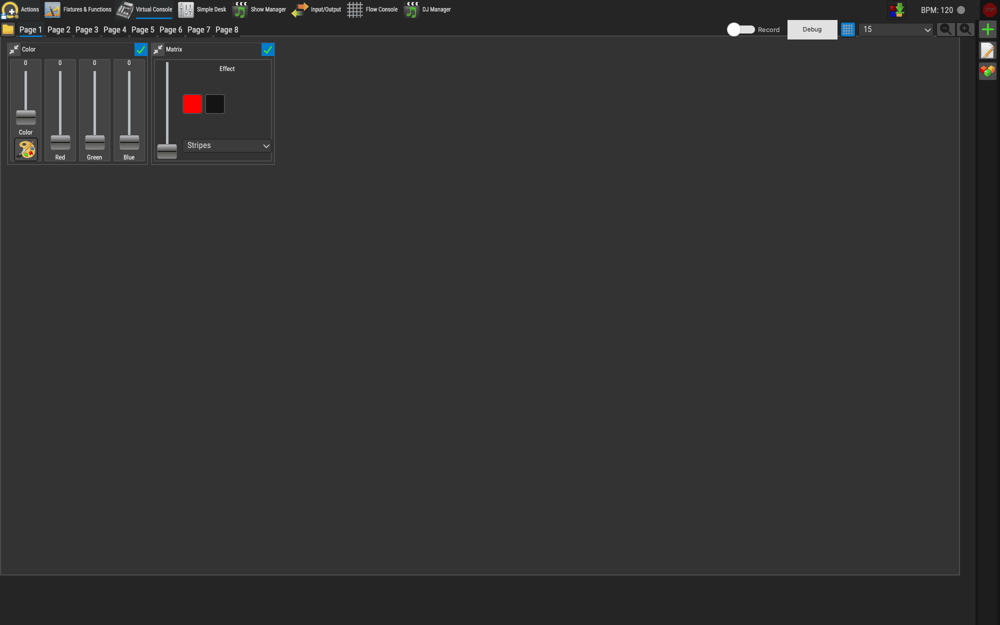</a> 08: Blizzard Lighting Pixellicious, 480 Channel

Planned page (text)
<pre># Pixellicious 1
## Color
- Color [Color, ColorMixer, 480 ch, 0 heads, 0 choices]
- Red [Color/Red, Fader, 160 ch, 0 heads, 0 choices]
- Green [Color/Green, Fader, 160 ch, 0 heads, 0 choices]
- Blue [Color/Blue, Fader, 160 ch, 0 heads, 0 choices]
## Matrix
- Effect [Matrix, ColorMixer, 0 ch, 160 heads, 0 choices]</pre>

</td></tr>
<tr><td align="center" valign="top"><a href="images/page-planner/09-strobe.png">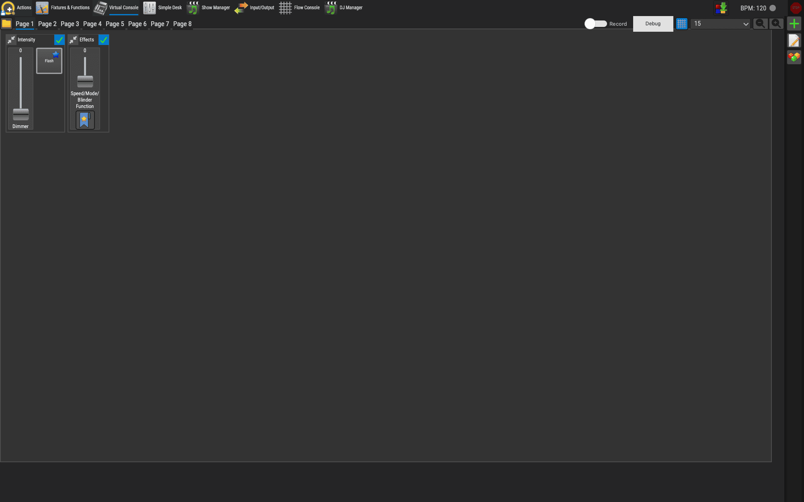</a> 09: Chauvet DMX Mega Strobe III, Standard

Planned page (text)
<pre># DMX Mega Strobe III 1
## Intensity
- Dimmer [Intensity/Dimmer, Fader, 1 ch, 0 heads, 0 choices]
- Flash [Intensity/Flash, Presets, 0 ch, 0 heads, 1 choices]
## Effects
- Speed/Mode/Blinder Function [Effect/speed/mode/blinder function, Presets, 1 ch, 0 heads, 0 choices]</pre>

</td><td align="center" valign="top"><a href="images/page-planner/10-hazer.png">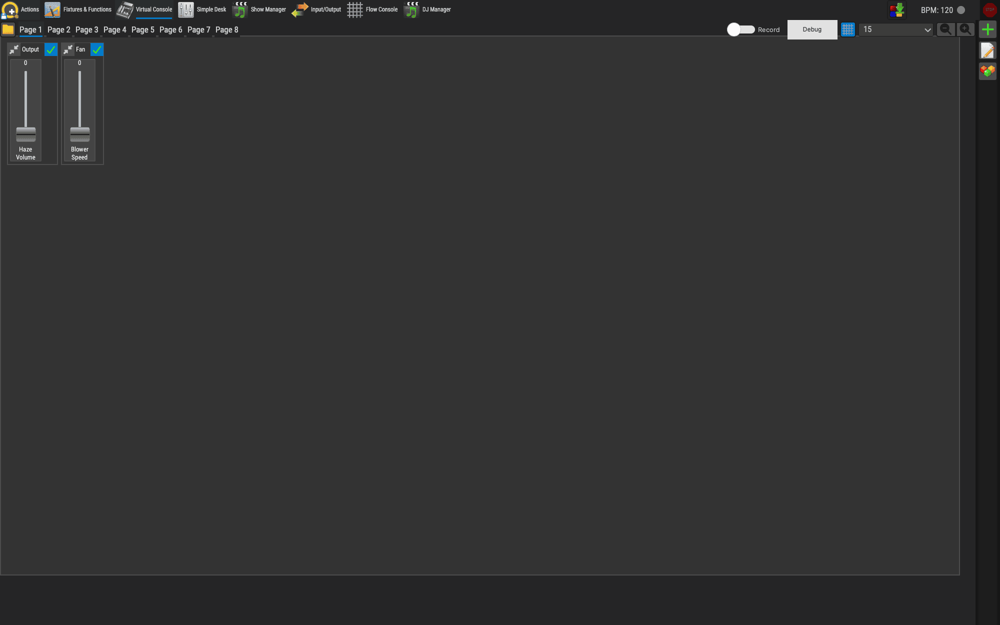</a> 10: Chauvet Hurricane Haze 2, Generic

Planned page (text)
<pre># Hurricane Haze 2 1
## Output
- Haze Volume [Effect/haze volume, Fader, 1 ch, 0 heads, 0 choices]
## Fan
- Blower Speed [Speed/blower speed, Fader, 1 ch, 0 heads, 0 choices]</pre>

</td></tr>
<tr><td align="center" valign="top"><a href="images/page-planner/11-dimmer-pack.png">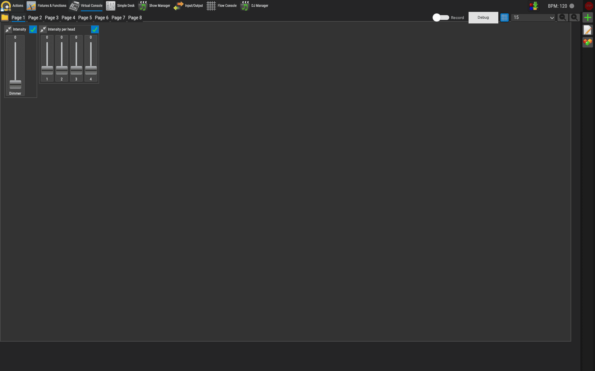</a> 11: Generic Dimmer, 4 channels

Planned page (text)
<pre># Generic Dimmer 1
## Intensity
- Dimmer [Intensity/Dimmer, Fader, 4 ch, 0 heads, 0 choices]
## Intensity per head (strip)
- 1 [Intensity/Dimmer@0, Fader, 1 ch, 0 heads, 0 choices]
- 2 [Intensity/Dimmer@1, Fader, 1 ch, 0 heads, 0 choices]
- 3 [Intensity/Dimmer@2, Fader, 1 ch, 0 heads, 0 choices]
- 4 [Intensity/Dimmer@3, Fader, 1 ch, 0 heads, 0 choices]</pre>

</td></tr>
</table>

## Show wizard, main rig (`wizardRig`)

The Show Wizard's master frame, one shot per frame page: all groups, then each group.

<table>
<tr><td align="center" valign="top"><a href="images/page-planner/g1-wizard-0-all.png">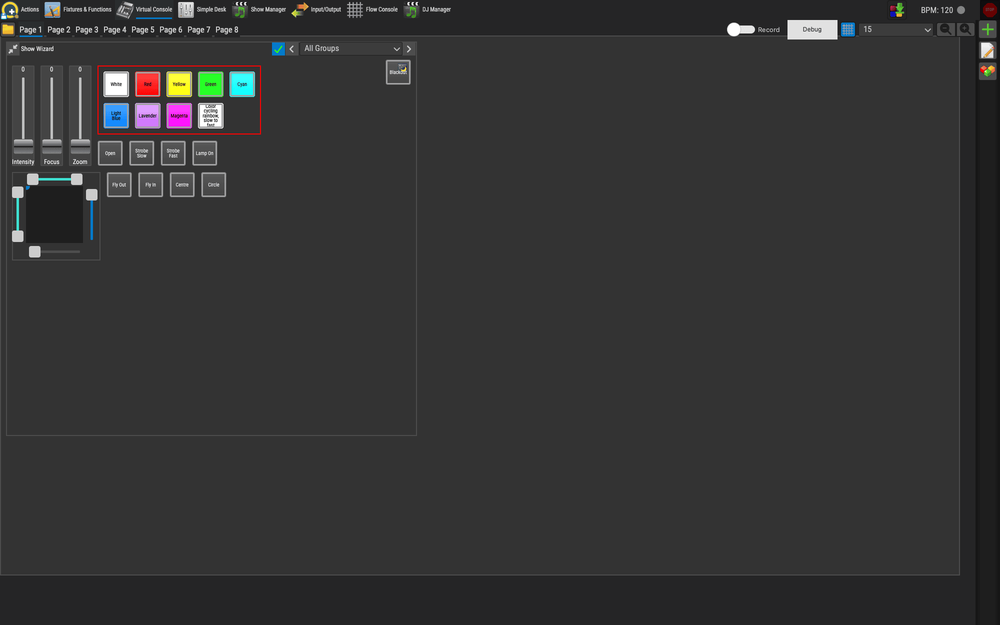</a> Frame page 0: all</td><td align="center" valign="top"><a href="images/page-planner/g1-wizard-1-pars.png">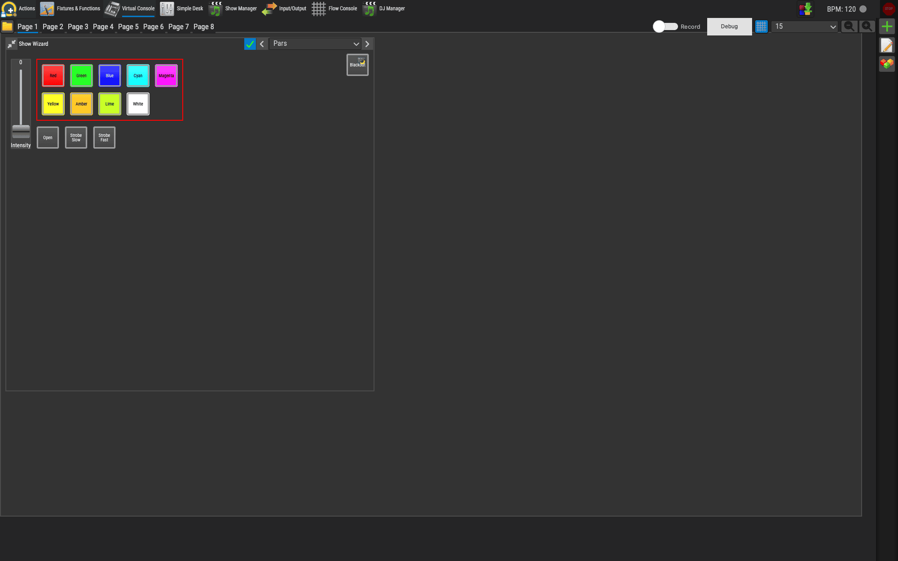</a> Frame page 1: pars</td><td align="center" valign="top"><a href="images/page-planner/g1-wizard-2-beams.png">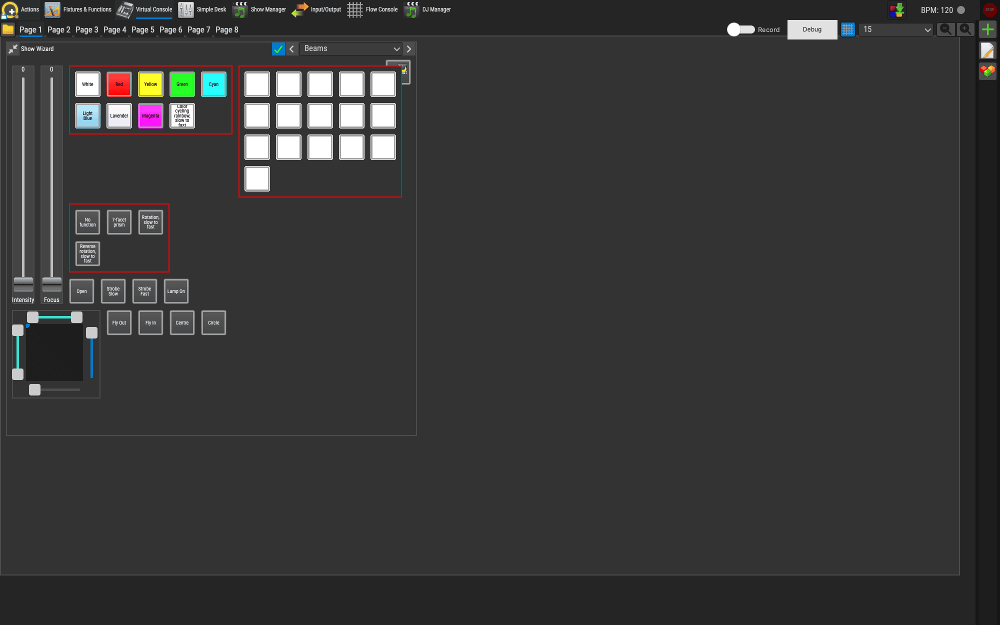</a> Frame page 2: beams</td></tr>
<tr><td align="center" valign="top"><a href="images/page-planner/g1-wizard-3-washes.png">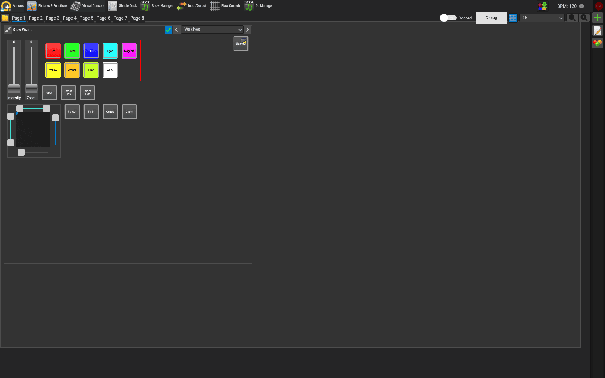</a> Frame page 3: washes</td><td align="center" valign="top"><a href="images/page-planner/g1-wizard-4-matrix.png">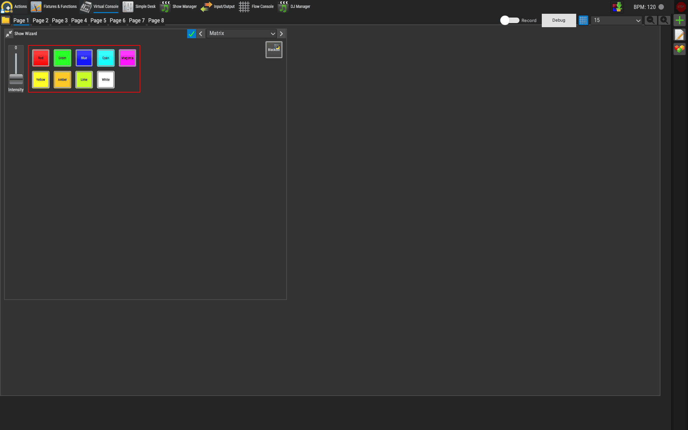</a> Frame page 4: matrix</td><td align="center" valign="top"> Frame page 5: mixed</td></tr>
</table>

## Show wizard, rig with gaps (`wizardRig`)

The Show Wizard's master frame, one shot per frame page: all groups, then each group. The rig has gaps: groups that lack some capabilities.

<table>
<tr><td align="center" valign="top"><a href="images/page-planner/g1-wizard-gaps-0-all.png">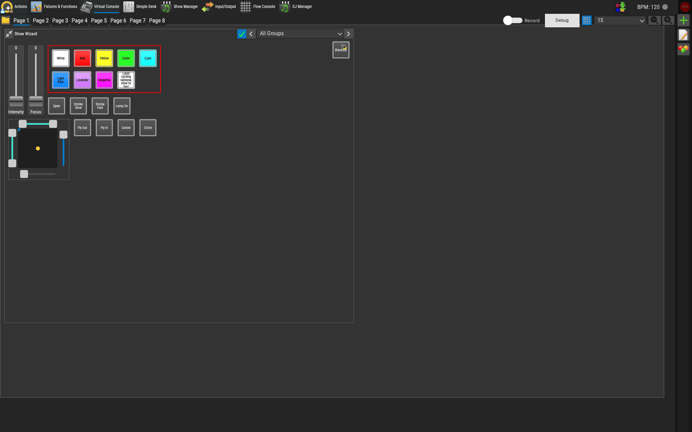</a> Frame page 0: all</td><td align="center" valign="top"><a href="images/page-planner/g1-wizard-gaps-1-rgb.png">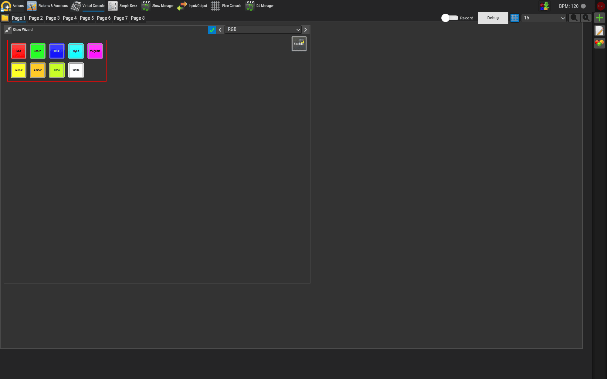</a> Frame page 1: rgb</td><td align="center" valign="top"><a href="images/page-planner/g1-wizard-gaps-2-hex.png">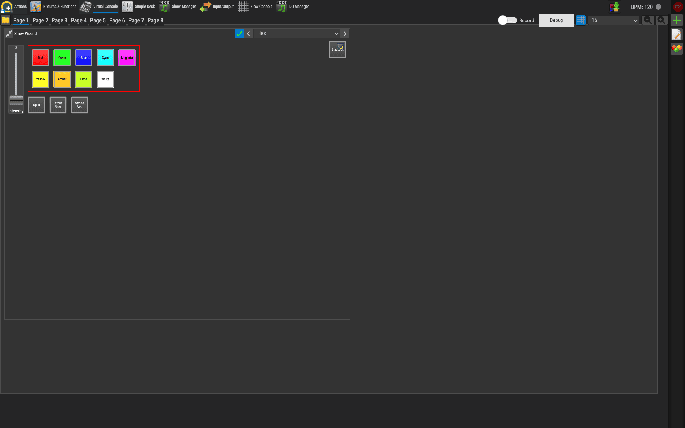</a> Frame page 2: hex</td></tr>
<tr><td align="center" valign="top"><a href="images/page-planner/g1-wizard-gaps-3-spots.png">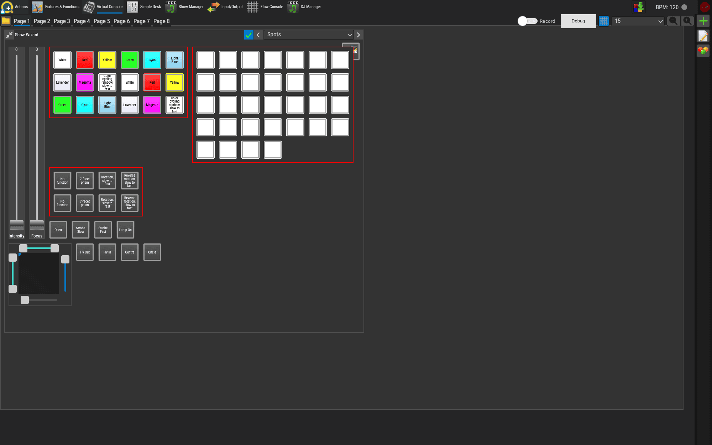</a> Frame page 3: spots</td><td align="center" valign="top"><a href="images/page-planner/g1-wizard-gaps-4-back-spots.png">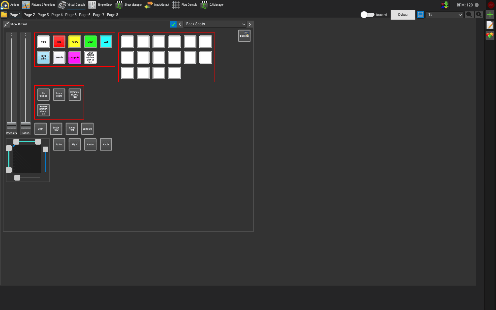</a> Frame page 4: back spots</td><td align="center" valign="top"><a href="images/page-planner/g1-wizard-gaps-5-gobo-mix.png">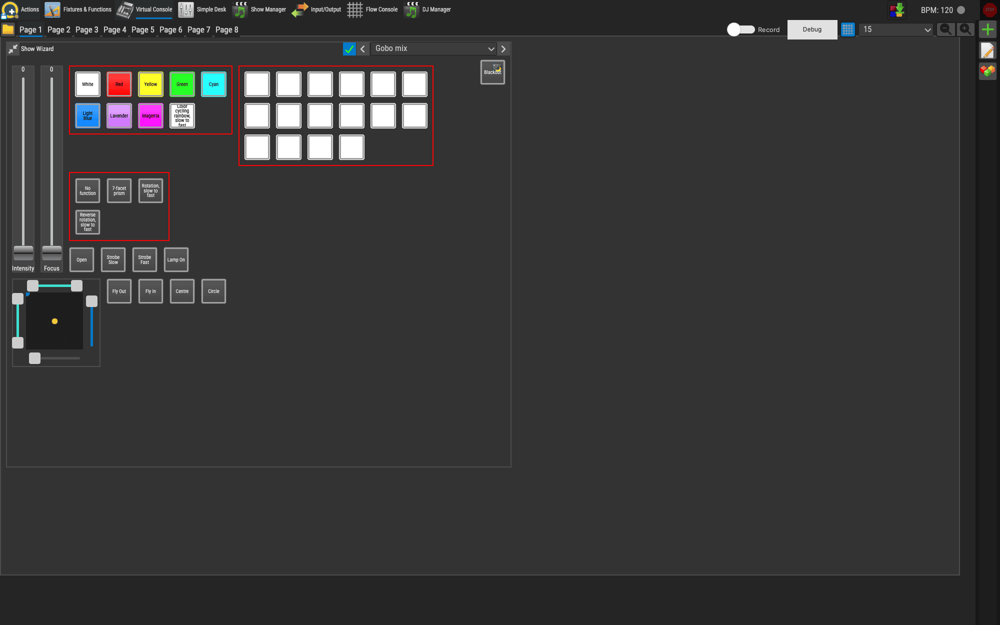</a> Frame page 5: gobo mix</td></tr>
</table>

## Planner engine, main rig (`engineRig`)

Pages planned for a fixture group with one strategy and head mode, built on the console. A plan that does not fit one console page continues on the next.

### All groups, intersection, merged heads

<table>
<tr><td align="center" valign="top"><a href="images/page-planner/g2-engine-0-all-intersection.png">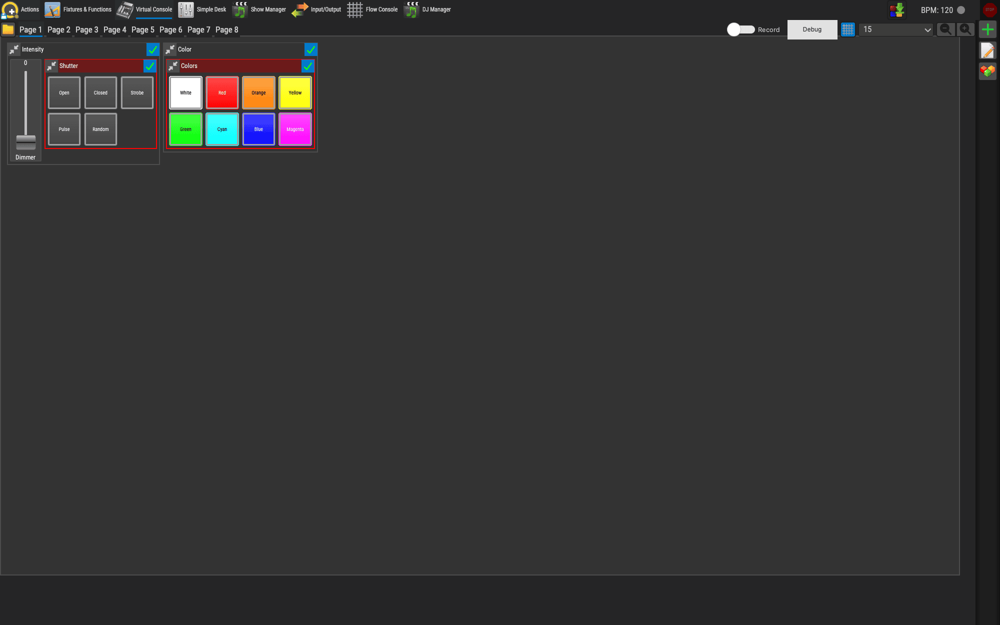</a> one console page</td></tr>
</table>

Plan and measurements (text)
<pre># All groups
## Intensity
- Dimmer [Intensity/Dimmer, Fader, 15 ch, 0 heads, 0 choices]
- Shutter [Shutter/Choices, Presets, 0 ch, 0 heads, 5 choices]
## Color
- Colors [Color/Choices, Presets, 0 ch, 0 heads, 8 choices]</pre>

### All groups, union, merged heads

<table>
<tr><td align="center" valign="top"><a href="images/page-planner/g2-engine-0-all-union-1.png">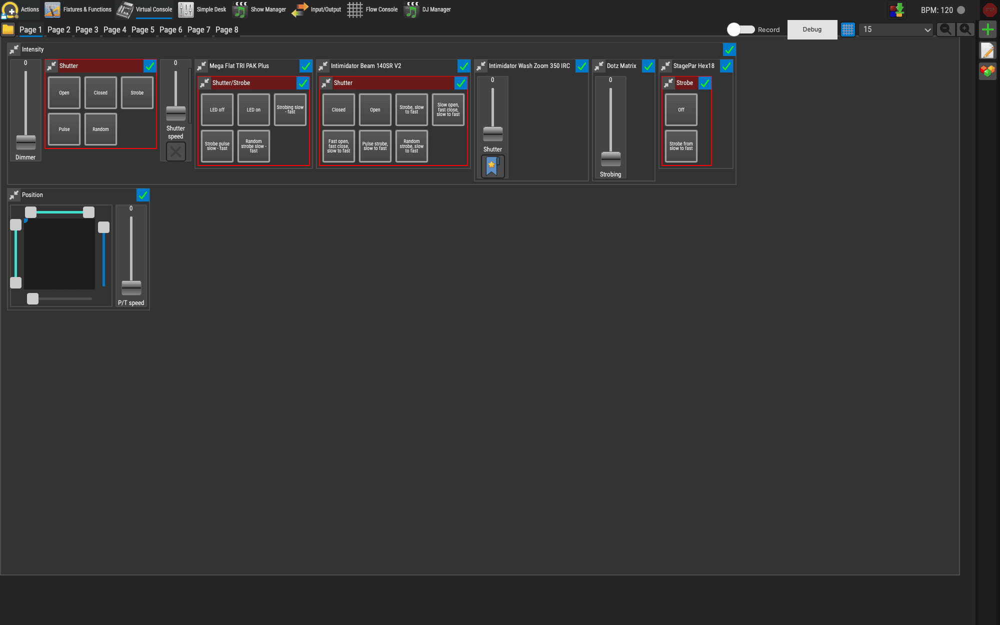</a> console page 1</td><td align="center" valign="top"><a href="images/page-planner/g2-engine-0-all-union-2.png">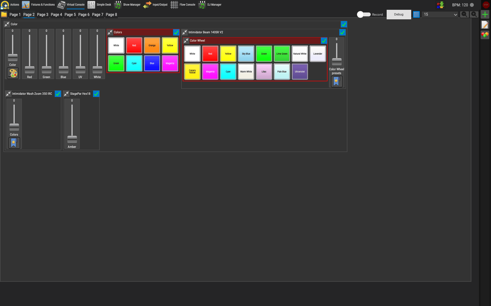</a> console page 2</td><td align="center" valign="top"><a href="images/page-planner/g2-engine-0-all-union-3.png">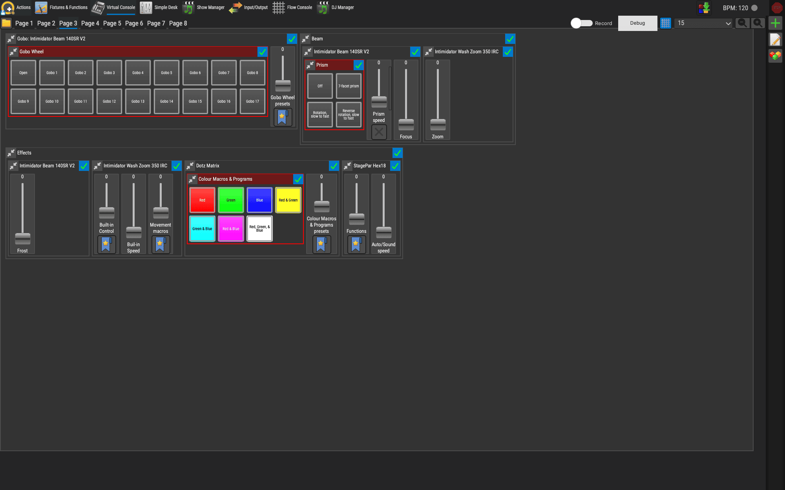</a> console page 3</td></tr>
<tr><td align="center" valign="top"><a href="images/page-planner/g2-engine-0-all-union-4.png">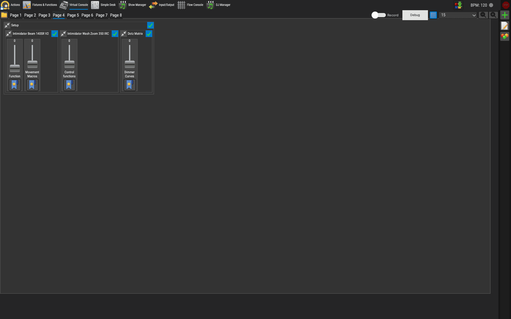</a> console page 4</td></tr>
</table>

Plan and measurements (text)
<pre># All groups
## Intensity
- Dimmer [Intensity/Dimmer, Fader, 15 ch, 0 heads, 0 choices]
- Shutter [Shutter/Choices, Presets, 0 ch, 0 heads, 5 choices]
- Shutter speed [Shutter#1/rate, Fader, 12 ch, 0 heads, 0 choices]
### Mega Flat TRI PAK Plus
- Shutter/Strobe [Shutter#1/buttons, Presets, 0 ch, 0 heads, 5 choices]
### Intimidator Beam 140SR V2
- Shutter [Shutter#1/buttons, Presets, 0 ch, 0 heads, 7 choices]
### Intimidator Wash Zoom 350 IRC
- Shutter [Shutter#1, Presets, 2 ch, 0 heads, 0 choices]
### Dotz Matrix
- Strobing [Shutter/ShutterStrobe, Fader, 1 ch, 0 heads, 0 choices]
### StagePar Hex18
- Strobe [Shutter#1/buttons, Presets, 0 ch, 0 heads, 2 choices]
## Position
- Position [Position, PanTilt, 24 ch, 6 heads, 0 choices]
- P/T speed [Speed/SpeedPanTilt, Fader, 6 ch, 0 heads, 0 choices]
## Color
- Color [Color, ColorMixer, 116 ch, 0 heads, 0 choices]
- Red [Color/Red, Fader, 32 ch, 0 heads, 0 choices]
- Green [Color/Green, Fader, 32 ch, 0 heads, 0 choices]
- Blue [Color/Blue, Fader, 32 ch, 0 heads, 0 choices]
- UV [Color/UV, Fader, 8 ch, 0 heads, 0 choices]
- White [Color/White, Fader, 10 ch, 0 heads, 0 choices]
- Colors [Color/Choices, Presets, 0 ch, 0 heads, 8 choices]
### Intimidator Beam 140SR V2
- Color Wheel [Colour#1/buttons, Presets, 0 ch, 0 heads, 15 choices]
- Color Wheel presets [Colour#1, Presets, 4 ch, 0 heads, 0 choices]
### Intimidator Wash Zoom 350 IRC
- Colors [Colour#1, Presets, 2 ch, 0 heads, 0 choices]
### StagePar Hex18
- Amber [Color/Amber, Fader, 2 ch, 0 heads, 0 choices]
## Gobo: Intimidator Beam 140SR V2
- Gobo Wheel [Gobo#1/buttons, Presets, 0 ch, 0 heads, 18 choices]
- Gobo Wheel presets [Gobo#1, Presets, 4 ch, 0 heads, 0 choices]
## Beam
### Intimidator Beam 140SR V2
- Prism [Prism#1/buttons, Presets, 0 ch, 0 heads, 4 choices]
- Prism speed [Prism#1/rate, Fader, 4 ch, 0 heads, 0 choices]
- Focus [Beam/BeamFocus, Fader, 4 ch, 0 heads, 0 choices]
### Intimidator Wash Zoom 350 IRC
- Zoom [Beam/BeamZoom, Fader, 2 ch, 0 heads, 0 choices]
## Effects
### Intimidator Beam 140SR V2
- Frost [Effect/frost, Fader, 4 ch, 0 heads, 0 choices]
### Intimidator Wash Zoom 350 IRC
- Built-in Control [Effect/built-in control, Presets, 2 ch, 0 heads, 0 choices]
- Buil-in Speed [Speed/buil-in speed, Fader, 2 ch, 0 heads, 0 choices]
- Movement macros [Effect/movement macros, Presets, 2 ch, 0 heads, 0 choices]
### Dotz Matrix
- Colour Macros &amp; Programs [Effect/colour macros &amp; programs/buttons, Presets, 0 ch, 0 heads, 7 choices]
- Colour Macros &amp; Programs presets [Effect/colour macros &amp; programs, Presets, 1 ch, 0 heads, 0 choices]
### StagePar Hex18
- Functions [Effect/functions, Presets, 2 ch, 0 heads, 0 choices]
- Auto/Sound speed [Speed/auto/sound speed, Fader, 2 ch, 0 heads, 0 choices]
## Setup
### Intimidator Beam 140SR V2
- Function [Maintenance/function, Presets, 4 ch, 0 heads, 0 choices]
- Movement Macros [Maintenance/movement macros, Presets, 4 ch, 0 heads, 0 choices]
### Intimidator Wash Zoom 350 IRC
- Control functions [Maintenance/control functions, Presets, 2 ch, 0 heads, 0 choices]
### Dotz Matrix
- Dimmer Curves [Maintenance/dimmer curves, Presets, 1 ch, 0 heads, 0 choices]</pre>

### All groups, master and models, merged heads

<table>
<tr><td align="center" valign="top"><a href="images/page-planner/g2-engine-0-all-master-p0.png">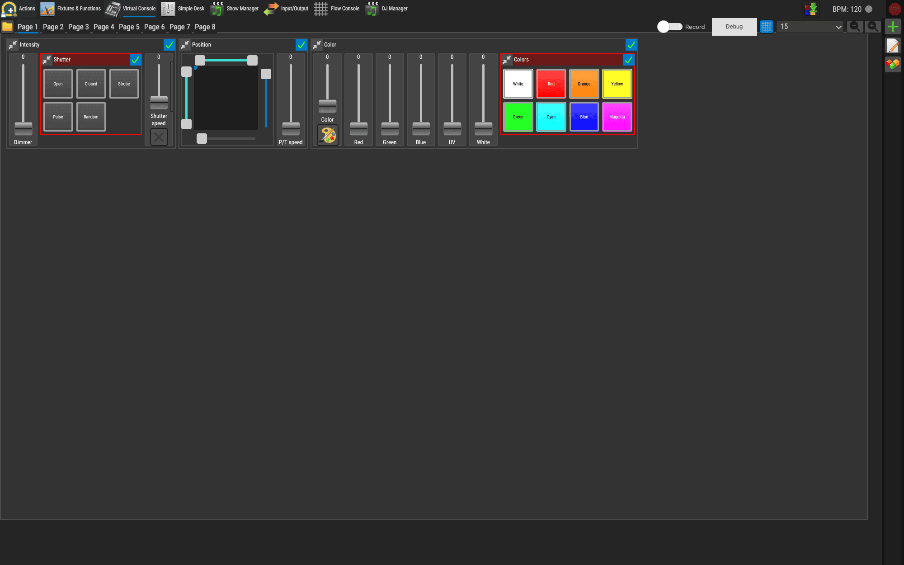</a> plan page 1</td><td align="center" valign="top"> plan page 2</td><td align="center" valign="top"> plan page 3</td></tr>
<tr><td align="center" valign="top"><a href="images/page-planner/g2-engine-0-all-master-p3.png">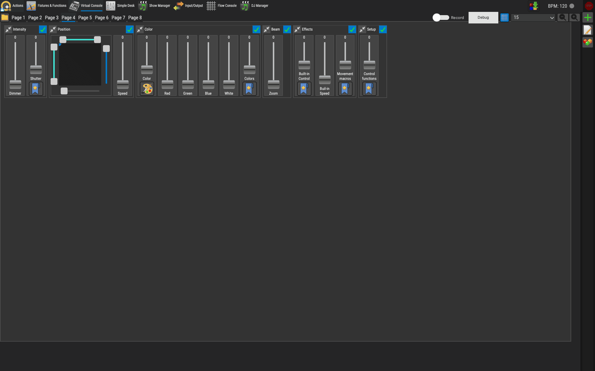</a> plan page 4</td><td align="center" valign="top"><a href="images/page-planner/g2-engine-0-all-master-p4.png">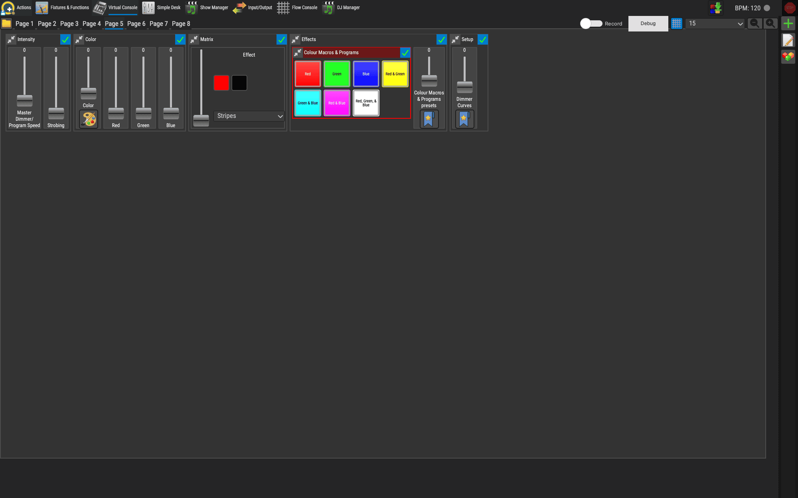</a> plan page 5</td><td align="center" valign="top"><a href="images/page-planner/g2-engine-0-all-master-p5.png">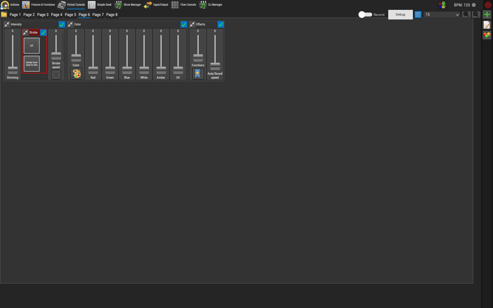</a> plan page 6</td></tr>
</table>

Plan and measurements (text)
<pre># All groups
## Intensity
- Dimmer [Intensity/Dimmer, Fader, 15 ch, 0 heads, 0 choices]
- Shutter [Shutter/Choices, Presets, 0 ch, 0 heads, 5 choices]
- Shutter speed [Shutter#1/rate, Fader, 12 ch, 0 heads, 0 choices]
## Position
- Position [Position, PanTilt, 24 ch, 6 heads, 0 choices]
- P/T speed [Speed/SpeedPanTilt, Fader, 6 ch, 0 heads, 0 choices]
## Color
- Color [Color, ColorMixer, 116 ch, 0 heads, 0 choices]
- Red [Color/Red, Fader, 32 ch, 0 heads, 0 choices]
- Green [Color/Green, Fader, 32 ch, 0 heads, 0 choices]
- Blue [Color/Blue, Fader, 32 ch, 0 heads, 0 choices]
- UV [Color/UV, Fader, 8 ch, 0 heads, 0 choices]
- White [Color/White, Fader, 10 ch, 0 heads, 0 choices]
- Colors [Color/Choices, Presets, 0 ch, 0 heads, 8 choices]
# Mega Flat TRI PAK Plus
## Intensity
- Shutter/Strobe [Shutter#1/buttons, Presets, 0 ch, 0 heads, 5 choices]
- Shutter/Strobe speed [Shutter#1/rate, Fader, 6 ch, 0 heads, 0 choices]
- Master dimmer [Intensity/Dimmer, Fader, 6 ch, 0 heads, 0 choices]
## Color
- Color [Color, ColorMixer, 24 ch, 0 heads, 0 choices]
- Red [Color/Red, Fader, 6 ch, 0 heads, 0 choices]
- Green [Color/Green, Fader, 6 ch, 0 heads, 0 choices]
- Blue [Color/Blue, Fader, 6 ch, 0 heads, 0 choices]
- UV [Color/UV, Fader, 6 ch, 0 heads, 0 choices]
# Intimidator Beam 140SR V2
## Intensity
- Dimmer [Intensity/Dimmer, Fader, 4 ch, 0 heads, 0 choices]
- Shutter [Shutter#1/buttons, Presets, 0 ch, 0 heads, 7 choices]
- Shutter speed [Shutter#1/rate, Fader, 4 ch, 0 heads, 0 choices]
## Position
- Position [Position, PanTilt, 16 ch, 4 heads, 0 choices]
- Pan/Tilt Speed [Speed/SpeedPanTilt, Fader, 4 ch, 0 heads, 0 choices]
## Color
- Color Wheel [Colour#1/buttons, Presets, 0 ch, 0 heads, 15 choices]
- Color Wheel presets [Colour#1, Presets, 4 ch, 0 heads, 0 choices]
## Gobo
- Gobo Wheel [Gobo#1/buttons, Presets, 0 ch, 0 heads, 18 choices]
- Gobo Wheel presets [Gobo#1, Presets, 4 ch, 0 heads, 0 choices]
## Beam
- Prism [Prism#1/buttons, Presets, 0 ch, 0 heads, 4 choices]
- Prism speed [Prism#1/rate, Fader, 4 ch, 0 heads, 0 choices]
- Focus [Beam/BeamFocus, Fader, 4 ch, 0 heads, 0 choices]
## Effects
- Frost [Effect/frost, Fader, 4 ch, 0 heads, 0 choices]
## Setup
- Function [Maintenance/function, Presets, 4 ch, 0 heads, 0 choices]
- Movement Macros [Maintenance/movement macros, Presets, 4 ch, 0 heads, 0 choices]
# Intimidator Wash Zoom 350 IRC
## Intensity
- Dimmer [Intensity/Dimmer, Fader, 2 ch, 0 heads, 0 choices]
- Shutter [Shutter#1, Presets, 2 ch, 0 heads, 0 choices]
## Position
- Position [Position, PanTilt, 8 ch, 2 heads, 0 choices]
- Speed [Speed/SpeedPanTilt, Fader, 2 ch, 0 heads, 0 choices]
## Color
- Color [Color, ColorMixer, 32 ch, 0 heads, 0 choices]
- Red [Color/Red, Fader, 8 ch, 0 heads, 0 choices]
- Green [Color/Green, Fader, 8 ch, 0 heads, 0 choices]
- Blue [Color/Blue, Fader, 8 ch, 0 heads, 0 choices]
- White [Color/White, Fader, 8 ch, 0 heads, 0 choices]
- Colors [Colour#1, Presets, 2 ch, 0 heads, 0 choices]
## Beam
- Zoom [Beam/BeamZoom, Fader, 2 ch, 0 heads, 0 choices]
## Effects
- Built-in Control [Effect/built-in control, Presets, 2 ch, 0 heads, 0 choices]
- Buil-in Speed [Speed/buil-in speed, Fader, 2 ch, 0 heads, 0 choices]
- Movement macros [Effect/movement macros, Presets, 2 ch, 0 heads, 0 choices]
## Setup
- Control functions [Maintenance/control functions, Presets, 2 ch, 0 heads, 0 choices]
# Dotz Matrix
## Intensity
- Master Dimmer/Program Speed [Intensity/Dimmer, Fader, 1 ch, 0 heads, 0 choices]
- Strobing [Shutter/ShutterStrobe, Fader, 1 ch, 0 heads, 0 choices]
## Color
- Color [Color, ColorMixer, 48 ch, 0 heads, 0 choices]
- Red [Color/Red, Fader, 16 ch, 0 heads, 0 choices]
- Green [Color/Green, Fader, 16 ch, 0 heads, 0 choices]
- Blue [Color/Blue, Fader, 16 ch, 0 heads, 0 choices]
## Matrix
- Effect [Matrix, ColorMixer, 0 ch, 16 heads, 0 choices]
## Effects
- Colour Macros &amp; Programs [Effect/colour macros &amp; programs/buttons, Presets, 0 ch, 0 heads, 7 choices]
- Colour Macros &amp; Programs presets [Effect/colour macros &amp; programs, Presets, 1 ch, 0 heads, 0 choices]
## Setup
- Dimmer Curves [Maintenance/dimmer curves, Presets, 1 ch, 0 heads, 0 choices]
# StagePar Hex18
## Intensity
- Dimming [Intensity/Dimmer, Fader, 2 ch, 0 heads, 0 choices]
- Strobe [Shutter#1/buttons, Presets, 0 ch, 0 heads, 2 choices]
- Strobe speed [Shutter#1/rate, Fader, 2 ch, 0 heads, 0 choices]
## Color
- Color [Color, ColorMixer, 12 ch, 0 heads, 0 choices]
- Red [Color/Red, Fader, 2 ch, 0 heads, 0 choices]
- Green [Color/Green, Fader, 2 ch, 0 heads, 0 choices]
- Blue [Color/Blue, Fader, 2 ch, 0 heads, 0 choices]
- White [Color/White, Fader, 2 ch, 0 heads, 0 choices]
- Amber [Color/Amber, Fader, 2 ch, 0 heads, 0 choices]
- UV [Color/UV, Fader, 2 ch, 0 heads, 0 choices]
## Effects
- Functions [Effect/functions, Presets, 2 ch, 0 heads, 0 choices]
- Auto/Sound speed [Speed/auto/sound speed, Fader, 2 ch, 0 heads, 0 choices]</pre>

### Pars, union, head strips

<table>
<tr><td align="center" valign="top"><a href="images/page-planner/g2-engine-1-pars.png">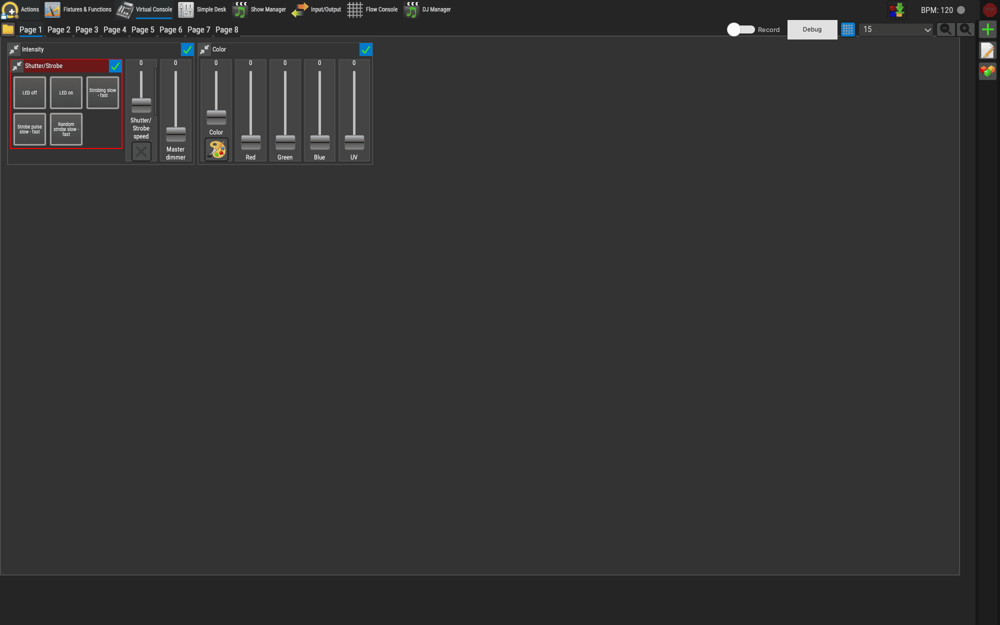</a> one console page</td></tr>
</table>

Plan and measurements (text)
<pre># Pars
## Intensity
- Shutter/Strobe [Shutter#1/buttons, Presets, 0 ch, 0 heads, 5 choices]
- Shutter/Strobe speed [Shutter#1/rate, Fader, 4 ch, 0 heads, 0 choices]
- Master dimmer [Intensity/Dimmer, Fader, 4 ch, 0 heads, 0 choices]
## Color
- Color [Color, ColorMixer, 16 ch, 0 heads, 0 choices]
- Red [Color/Red, Fader, 4 ch, 0 heads, 0 choices]
- Green [Color/Green, Fader, 4 ch, 0 heads, 0 choices]
- Blue [Color/Blue, Fader, 4 ch, 0 heads, 0 choices]
- UV [Color/UV, Fader, 4 ch, 0 heads, 0 choices]</pre>

### Beams, union, head strips

<table>
<tr><td align="center" valign="top"> one console page</td></tr>
</table>

Plan and measurements (text)
<pre># Beams
## Intensity
- Dimmer [Intensity/Dimmer, Fader, 4 ch, 0 heads, 0 choices]
- Shutter [Shutter#1/buttons, Presets, 0 ch, 0 heads, 7 choices]
- Shutter speed [Shutter#1/rate, Fader, 4 ch, 0 heads, 0 choices]
## Position
- Position [Position, PanTilt, 16 ch, 4 heads, 0 choices]
- Pan/Tilt Speed [Speed/SpeedPanTilt, Fader, 4 ch, 0 heads, 0 choices]
## Color
- Color Wheel [Colour#1/buttons, Presets, 0 ch, 0 heads, 15 choices]
- Color Wheel presets [Colour#1, Presets, 4 ch, 0 heads, 0 choices]
## Gobo
- Gobo Wheel [Gobo#1/buttons, Presets, 0 ch, 0 heads, 18 choices]
- Gobo Wheel presets [Gobo#1, Presets, 4 ch, 0 heads, 0 choices]
## Beam
- Prism [Prism#1/buttons, Presets, 0 ch, 0 heads, 4 choices]
- Prism speed [Prism#1/rate, Fader, 4 ch, 0 heads, 0 choices]
- Focus [Beam/BeamFocus, Fader, 4 ch, 0 heads, 0 choices]
## Effects
- Frost [Effect/frost, Fader, 4 ch, 0 heads, 0 choices]
## Setup
- Function [Maintenance/function, Presets, 4 ch, 0 heads, 0 choices]
- Movement Macros [Maintenance/movement macros, Presets, 4 ch, 0 heads, 0 choices]</pre>

### Washes, union, head strips

<table>
<tr><td align="center" valign="top"><a href="images/page-planner/g2-engine-3-washes.png">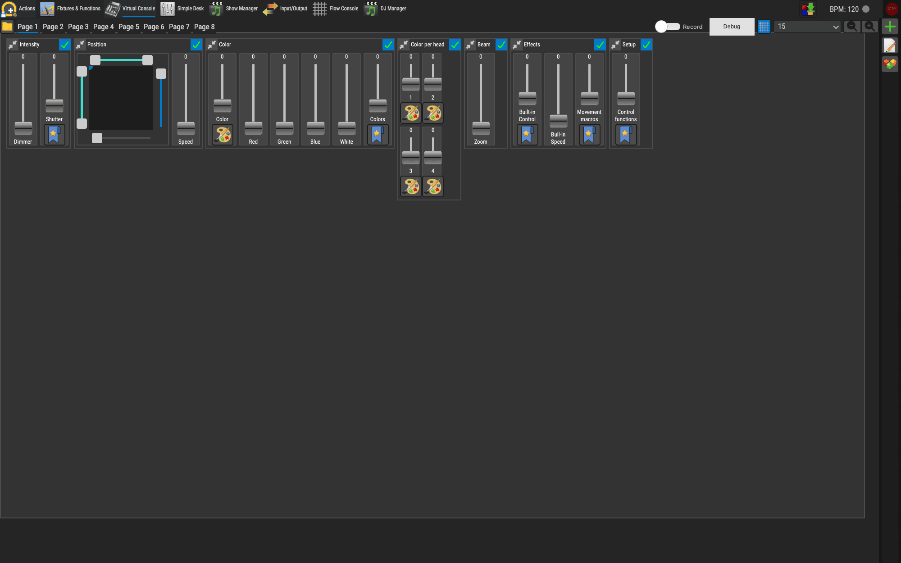</a> one console page</td></tr>
</table>

Plan and measurements (text)
<pre># Washes
## Intensity
- Dimmer [Intensity/Dimmer, Fader, 2 ch, 0 heads, 0 choices]
- Shutter [Shutter#1, Presets, 2 ch, 0 heads, 0 choices]
## Position
- Position [Position, PanTilt, 8 ch, 2 heads, 0 choices]
- Speed [Speed/SpeedPanTilt, Fader, 2 ch, 0 heads, 0 choices]
## Color
- Color [Color, ColorMixer, 32 ch, 0 heads, 0 choices]
- Red [Color/Red, Fader, 8 ch, 0 heads, 0 choices]
- Green [Color/Green, Fader, 8 ch, 0 heads, 0 choices]
- Blue [Color/Blue, Fader, 8 ch, 0 heads, 0 choices]
- White [Color/White, Fader, 8 ch, 0 heads, 0 choices]
- Colors [Colour#1, Presets, 2 ch, 0 heads, 0 choices]
## Color per head (strip)
- 1 [Color@0, ColorMixer, 8 ch, 0 heads, 0 choices]
- 2 [Color@1, ColorMixer, 8 ch, 0 heads, 0 choices]
- 3 [Color@2, ColorMixer, 8 ch, 0 heads, 0 choices]
- 4 [Color@3, ColorMixer, 8 ch, 0 heads, 0 choices]
## Beam
- Zoom [Beam/BeamZoom, Fader, 2 ch, 0 heads, 0 choices]
## Effects
- Built-in Control [Effect/built-in control, Presets, 2 ch, 0 heads, 0 choices]
- Buil-in Speed [Speed/buil-in speed, Fader, 2 ch, 0 heads, 0 choices]
- Movement macros [Effect/movement macros, Presets, 2 ch, 0 heads, 0 choices]
## Setup
- Control functions [Maintenance/control functions, Presets, 2 ch, 0 heads, 0 choices]</pre>

### Matrix, union, head strips

<table>
<tr><td align="center" valign="top"> one console page</td></tr>
</table>

Plan and measurements (text)
<pre># Matrix
## Intensity
- Master Dimmer/Program Speed [Intensity/Dimmer, Fader, 1 ch, 0 heads, 0 choices]
- Strobing [Shutter/ShutterStrobe, Fader, 1 ch, 0 heads, 0 choices]
## Color
- Color [Color, ColorMixer, 48 ch, 0 heads, 0 choices]
- Red [Color/Red, Fader, 16 ch, 0 heads, 0 choices]
- Green [Color/Green, Fader, 16 ch, 0 heads, 0 choices]
- Blue [Color/Blue, Fader, 16 ch, 0 heads, 0 choices]
## Color per head (strip)
- 1 [Color@0, ColorMixer, 3 ch, 0 heads, 0 choices]
- 2 [Color@1, ColorMixer, 3 ch, 0 heads, 0 choices]
- 3 [Color@2, ColorMixer, 3 ch, 0 heads, 0 choices]
- 4 [Color@3, ColorMixer, 3 ch, 0 heads, 0 choices]
- 5 [Color@4, ColorMixer, 3 ch, 0 heads, 0 choices]
- 6 [Color@5, ColorMixer, 3 ch, 0 heads, 0 choices]
- 7 [Color@6, ColorMixer, 3 ch, 0 heads, 0 choices]
- 8 [Color@7, ColorMixer, 3 ch, 0 heads, 0 choices]
- 9 [Color@8, ColorMixer, 3 ch, 0 heads, 0 choices]
- 10 [Color@9, ColorMixer, 3 ch, 0 heads, 0 choices]
- 11 [Color@10, ColorMixer, 3 ch, 0 heads, 0 choices]
- 12 [Color@11, ColorMixer, 3 ch, 0 heads, 0 choices]
- 13 [Color@12, ColorMixer, 3 ch, 0 heads, 0 choices]
- 14 [Color@13, ColorMixer, 3 ch, 0 heads, 0 choices]
- 15 [Color@14, ColorMixer, 3 ch, 0 heads, 0 choices]
- 16 [Color@15, ColorMixer, 3 ch, 0 heads, 0 choices]
## Matrix
- Effect [Matrix, ColorMixer, 0 ch, 16 heads, 0 choices]
## Effects
- Colour Macros &amp; Programs [Effect/colour macros &amp; programs/buttons, Presets, 0 ch, 0 heads, 7 choices]
- Colour Macros &amp; Programs presets [Effect/colour macros &amp; programs, Presets, 1 ch, 0 heads, 0 choices]
## Setup
- Dimmer Curves [Maintenance/dimmer curves, Presets, 1 ch, 0 heads, 0 choices]</pre>

### Matrix, union, merged heads

<table>
<tr><td align="center" valign="top"> one console page</td></tr>
</table>

Plan and measurements (text)
<pre># Matrix
## Intensity
- Master Dimmer/Program Speed [Intensity/Dimmer, Fader, 1 ch, 0 heads, 0 choices]
- Strobing [Shutter/ShutterStrobe, Fader, 1 ch, 0 heads, 0 choices]
## Color
- Color [Color, ColorMixer, 48 ch, 0 heads, 0 choices]
- Red [Color/Red, Fader, 16 ch, 0 heads, 0 choices]
- Green [Color/Green, Fader, 16 ch, 0 heads, 0 choices]
- Blue [Color/Blue, Fader, 16 ch, 0 heads, 0 choices]
## Matrix
- Effect [Matrix, ColorMixer, 0 ch, 16 heads, 0 choices]
## Effects
- Colour Macros &amp; Programs [Effect/colour macros &amp; programs/buttons, Presets, 0 ch, 0 heads, 7 choices]
- Colour Macros &amp; Programs presets [Effect/colour macros &amp; programs, Presets, 1 ch, 0 heads, 0 choices]
## Setup
- Dimmer Curves [Maintenance/dimmer curves, Presets, 1 ch, 0 heads, 0 choices]</pre>

### Mixed, intersection, head strips

<table>
<tr><td align="center" valign="top"><a href="images/page-planner/g2-engine-5-mixed-intersection.png">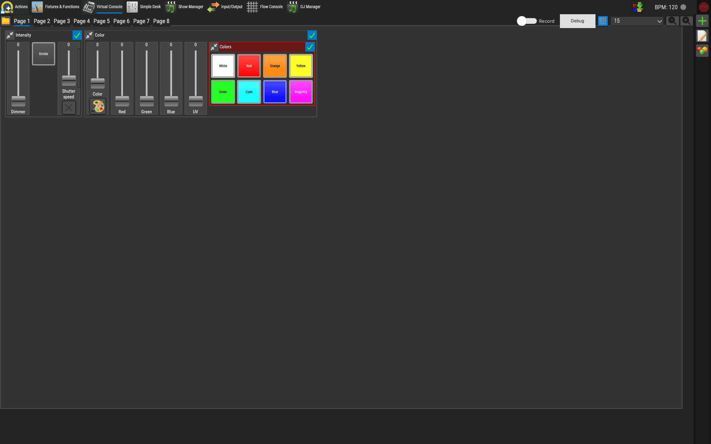</a> one console page</td></tr>
</table>

Plan and measurements (text)
<pre># Mixed
## Intensity
- Dimmer [Intensity/Dimmer, Fader, 4 ch, 0 heads, 0 choices]
- Shutter [Shutter/Choices, Presets, 0 ch, 0 heads, 1 choices]
- Shutter speed [Shutter#1/rate, Fader, 4 ch, 0 heads, 0 choices]
## Color
- Color [Color, ColorMixer, 20 ch, 0 heads, 0 choices]
- Red [Color/Red, Fader, 4 ch, 0 heads, 0 choices]
- Green [Color/Green, Fader, 4 ch, 0 heads, 0 choices]
- Blue [Color/Blue, Fader, 4 ch, 0 heads, 0 choices]
- UV [Color/UV, Fader, 4 ch, 0 heads, 0 choices]
- Colors [Color/Choices, Presets, 0 ch, 0 heads, 8 choices]</pre>

### Mixed, union, head strips

<table>
<tr><td align="center" valign="top"><a href="images/page-planner/g2-engine-5-mixed-union.png">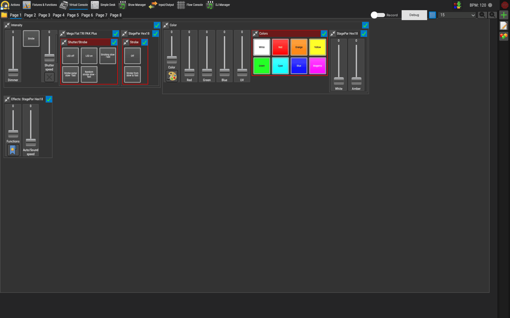</a> one console page</td></tr>
</table>

Plan and measurements (text)
<pre># Mixed
## Intensity
- Dimmer [Intensity/Dimmer, Fader, 4 ch, 0 heads, 0 choices]
- Shutter [Shutter/Choices, Presets, 0 ch, 0 heads, 1 choices]
- Shutter speed [Shutter#1/rate, Fader, 4 ch, 0 heads, 0 choices]
### Mega Flat TRI PAK Plus
- Shutter/Strobe [Shutter#1/buttons, Presets, 0 ch, 0 heads, 5 choices]
### StagePar Hex18
- Strobe [Shutter#1/buttons, Presets, 0 ch, 0 heads, 2 choices]
## Color
- Color [Color, ColorMixer, 20 ch, 0 heads, 0 choices]
- Red [Color/Red, Fader, 4 ch, 0 heads, 0 choices]
- Green [Color/Green, Fader, 4 ch, 0 heads, 0 choices]
- Blue [Color/Blue, Fader, 4 ch, 0 heads, 0 choices]
- UV [Color/UV, Fader, 4 ch, 0 heads, 0 choices]
- Colors [Color/Choices, Presets, 0 ch, 0 heads, 8 choices]
### StagePar Hex18
- White [Color/White, Fader, 2 ch, 0 heads, 0 choices]
- Amber [Color/Amber, Fader, 2 ch, 0 heads, 0 choices]
## Effects: StagePar Hex18
- Functions [Effect/functions, Presets, 2 ch, 0 heads, 0 choices]
- Auto/Sound speed [Speed/auto/sound speed, Fader, 2 ch, 0 heads, 0 choices]</pre>

### Mixed, master and models, head strips

<table>
<tr><td align="center" valign="top"> plan page 1</td><td align="center" valign="top"><a href="images/page-planner/g2-engine-5-mixed-master-p1.png">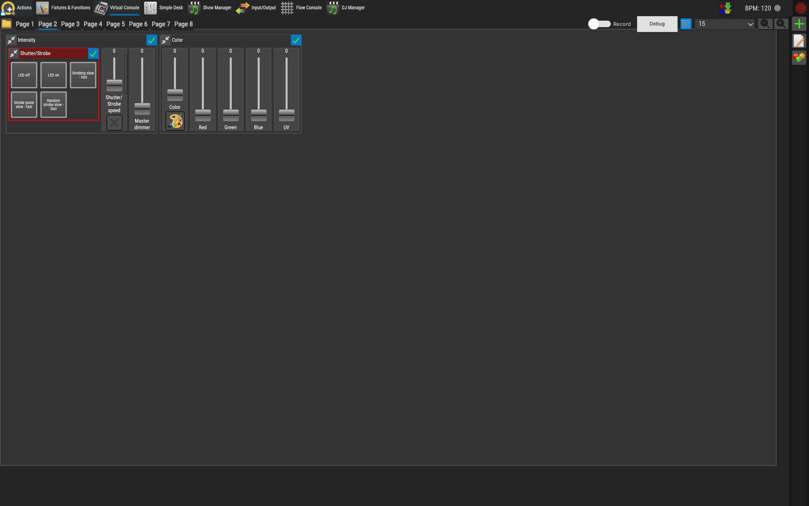</a> plan page 2</td><td align="center" valign="top"> plan page 3</td></tr>
</table>

Plan and measurements (text)
<pre># Mixed
## Intensity
- Dimmer [Intensity/Dimmer, Fader, 4 ch, 0 heads, 0 choices]
- Shutter [Shutter/Choices, Presets, 0 ch, 0 heads, 1 choices]
- Shutter speed [Shutter#1/rate, Fader, 4 ch, 0 heads, 0 choices]
## Color
- Color [Color, ColorMixer, 20 ch, 0 heads, 0 choices]
- Red [Color/Red, Fader, 4 ch, 0 heads, 0 choices]
- Green [Color/Green, Fader, 4 ch, 0 heads, 0 choices]
- Blue [Color/Blue, Fader, 4 ch, 0 heads, 0 choices]
- UV [Color/UV, Fader, 4 ch, 0 heads, 0 choices]
- Colors [Color/Choices, Presets, 0 ch, 0 heads, 8 choices]
# Mega Flat TRI PAK Plus
## Intensity
- Shutter/Strobe [Shutter#1/buttons, Presets, 0 ch, 0 heads, 5 choices]
- Shutter/Strobe speed [Shutter#1/rate, Fader, 2 ch, 0 heads, 0 choices]
- Master dimmer [Intensity/Dimmer, Fader, 2 ch, 0 heads, 0 choices]
## Color
- Color [Color, ColorMixer, 8 ch, 0 heads, 0 choices]
- Red [Color/Red, Fader, 2 ch, 0 heads, 0 choices]
- Green [Color/Green, Fader, 2 ch, 0 heads, 0 choices]
- Blue [Color/Blue, Fader, 2 ch, 0 heads, 0 choices]
- UV [Color/UV, Fader, 2 ch, 0 heads, 0 choices]
# StagePar Hex18
## Intensity
- Dimming [Intensity/Dimmer, Fader, 2 ch, 0 heads, 0 choices]
- Strobe [Shutter#1/buttons, Presets, 0 ch, 0 heads, 2 choices]
- Strobe speed [Shutter#1/rate, Fader, 2 ch, 0 heads, 0 choices]
## Color
- Color [Color, ColorMixer, 12 ch, 0 heads, 0 choices]
- Red [Color/Red, Fader, 2 ch, 0 heads, 0 choices]
- Green [Color/Green, Fader, 2 ch, 0 heads, 0 choices]
- Blue [Color/Blue, Fader, 2 ch, 0 heads, 0 choices]
- White [Color/White, Fader, 2 ch, 0 heads, 0 choices]
- Amber [Color/Amber, Fader, 2 ch, 0 heads, 0 choices]
- UV [Color/UV, Fader, 2 ch, 0 heads, 0 choices]
## Effects
- Functions [Effect/functions, Presets, 2 ch, 0 heads, 0 choices]
- Auto/Sound speed [Speed/auto/sound speed, Fader, 2 ch, 0 heads, 0 choices]</pre>

## Planner engine, rig with gaps (`engineRig`)

Pages planned for a fixture group with one strategy and head mode, built on the console. A plan that does not fit one console page continues on the next.

### RGB, union, head strips

<table>
<tr><td align="center" valign="top"><a href="images/page-planner/g2-engine-gaps-rgb.png">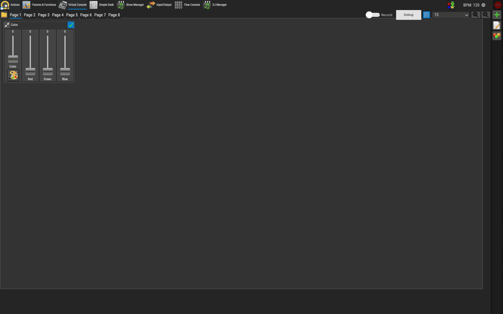</a> one console page</td></tr>
</table>

Plan and measurements (text)
<pre># RGB
## Color
- Color [Color, ColorMixer, 6 ch, 0 heads, 0 choices]
- Red [Color/Red, Fader, 2 ch, 0 heads, 0 choices]
- Green [Color/Green, Fader, 2 ch, 0 heads, 0 choices]
- Blue [Color/Blue, Fader, 2 ch, 0 heads, 0 choices]</pre>

### Hex, union, head strips

<table>
<tr><td align="center" valign="top"> one console page</td></tr>
</table>

Plan and measurements (text)
<pre># Hex
## Intensity
- Dimming [Intensity/Dimmer, Fader, 2 ch, 0 heads, 0 choices]
- Strobe [Shutter#1/buttons, Presets, 0 ch, 0 heads, 2 choices]
- Strobe speed [Shutter#1/rate, Fader, 2 ch, 0 heads, 0 choices]
## Color
- Color [Color, ColorMixer, 12 ch, 0 heads, 0 choices]
- Red [Color/Red, Fader, 2 ch, 0 heads, 0 choices]
- Green [Color/Green, Fader, 2 ch, 0 heads, 0 choices]
- Blue [Color/Blue, Fader, 2 ch, 0 heads, 0 choices]
- White [Color/White, Fader, 2 ch, 0 heads, 0 choices]
- Amber [Color/Amber, Fader, 2 ch, 0 heads, 0 choices]
- UV [Color/UV, Fader, 2 ch, 0 heads, 0 choices]
## Effects
- Functions [Effect/functions, Presets, 2 ch, 0 heads, 0 choices]
- Auto/Sound speed [Speed/auto/sound speed, Fader, 2 ch, 0 heads, 0 choices]</pre>

### Spots, union, head strips

<table>
<tr><td align="center" valign="top"><a href="images/page-planner/g2-engine-gaps-spots.png">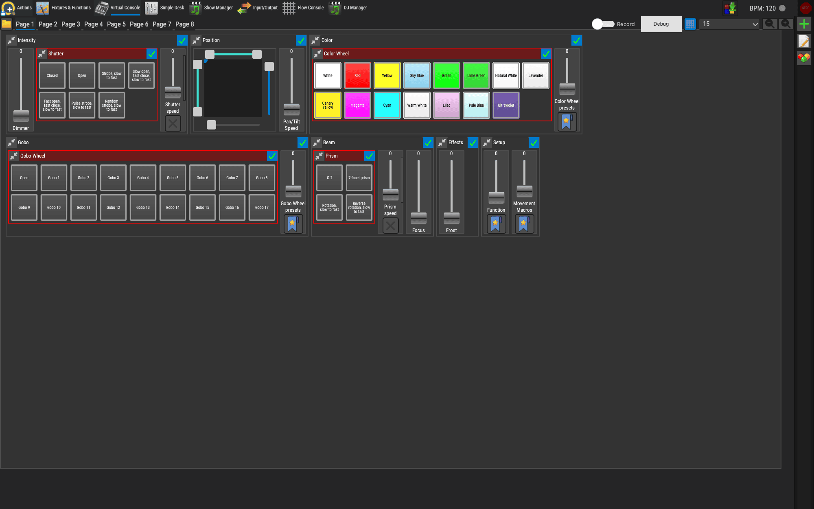</a> one console page</td></tr>
</table>

Plan and measurements (text)
<pre># Spots
## Intensity
- Dimmer [Intensity/Dimmer, Fader, 2 ch, 0 heads, 0 choices]
- Shutter [Shutter#1/buttons, Presets, 0 ch, 0 heads, 7 choices]
- Shutter speed [Shutter#1/rate, Fader, 2 ch, 0 heads, 0 choices]
## Position
- Position [Position, PanTilt, 8 ch, 2 heads, 0 choices]
- Pan/Tilt Speed [Speed/SpeedPanTilt, Fader, 2 ch, 0 heads, 0 choices]
## Color
- Color Wheel [Colour#1/buttons, Presets, 0 ch, 0 heads, 15 choices]
- Color Wheel presets [Colour#1, Presets, 2 ch, 0 heads, 0 choices]
## Gobo
- Gobo Wheel [Gobo#1/buttons, Presets, 0 ch, 0 heads, 18 choices]
- Gobo Wheel presets [Gobo#1, Presets, 2 ch, 0 heads, 0 choices]
## Beam
- Prism [Prism#1/buttons, Presets, 0 ch, 0 heads, 4 choices]
- Prism speed [Prism#1/rate, Fader, 2 ch, 0 heads, 0 choices]
- Focus [Beam/BeamFocus, Fader, 2 ch, 0 heads, 0 choices]
## Effects
- Frost [Effect/frost, Fader, 2 ch, 0 heads, 0 choices]
## Setup
- Function [Maintenance/function, Presets, 2 ch, 0 heads, 0 choices]
- Movement Macros [Maintenance/movement macros, Presets, 2 ch, 0 heads, 0 choices]</pre>

### Back spots, union, head strips

<table>
<tr><td align="center" valign="top"> one console page</td></tr>
</table>

Plan and measurements (text)
<pre># Back Spots
## Intensity
- Dimmer [Intensity/Dimmer, Fader, 2 ch, 0 heads, 0 choices]
- Shutter [Shutter#1/buttons, Presets, 0 ch, 0 heads, 7 choices]
- Shutter speed [Shutter#1/rate, Fader, 2 ch, 0 heads, 0 choices]
## Position
- Position [Position, PanTilt, 8 ch, 2 heads, 0 choices]
- Pan/Tilt Speed [Speed/SpeedPanTilt, Fader, 2 ch, 0 heads, 0 choices]
## Color
- Color Wheel [Colour#1/buttons, Presets, 0 ch, 0 heads, 15 choices]
- Color Wheel presets [Colour#1, Presets, 2 ch, 0 heads, 0 choices]
## Gobo
- Gobo Wheel [Gobo#1/buttons, Presets, 0 ch, 0 heads, 18 choices]
- Gobo Wheel presets [Gobo#1, Presets, 2 ch, 0 heads, 0 choices]
## Beam
- Prism [Prism#1/buttons, Presets, 0 ch, 0 heads, 4 choices]
- Prism speed [Prism#1/rate, Fader, 2 ch, 0 heads, 0 choices]
- Focus [Beam/BeamFocus, Fader, 2 ch, 0 heads, 0 choices]
## Effects
- Frost [Effect/frost, Fader, 2 ch, 0 heads, 0 choices]
## Setup
- Function [Maintenance/function, Presets, 2 ch, 0 heads, 0 choices]
- Movement Macros [Maintenance/movement macros, Presets, 2 ch, 0 heads, 0 choices]</pre>

### Gobo mix, union, head strips

<table>
<tr><td align="center" valign="top"><a href="images/page-planner/g2-engine-gaps-gobo-mix-1.png">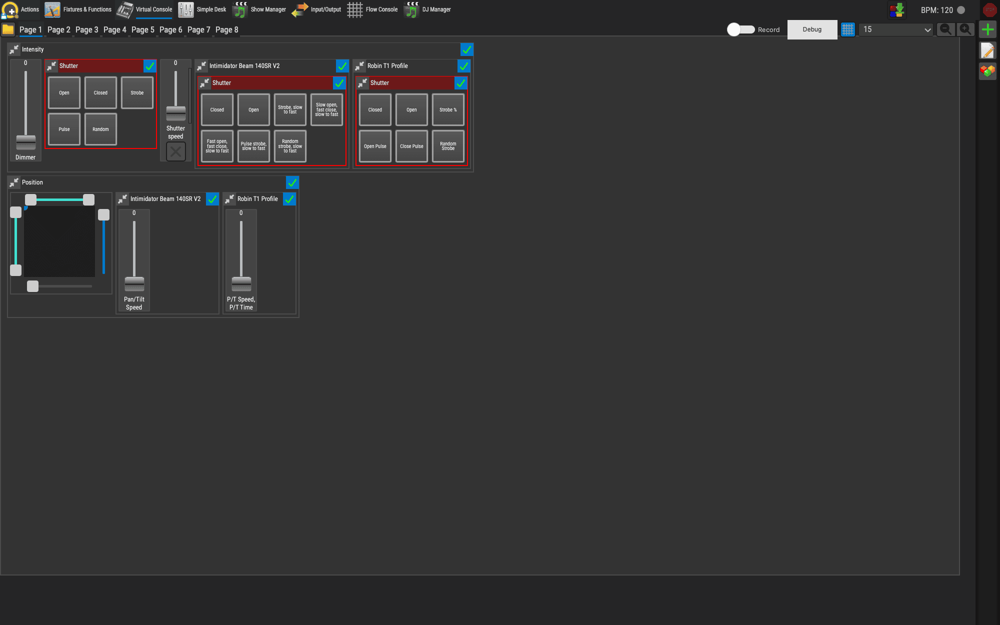</a> console page 1</td><td align="center" valign="top"><a href="images/page-planner/g2-engine-gaps-gobo-mix-2.png">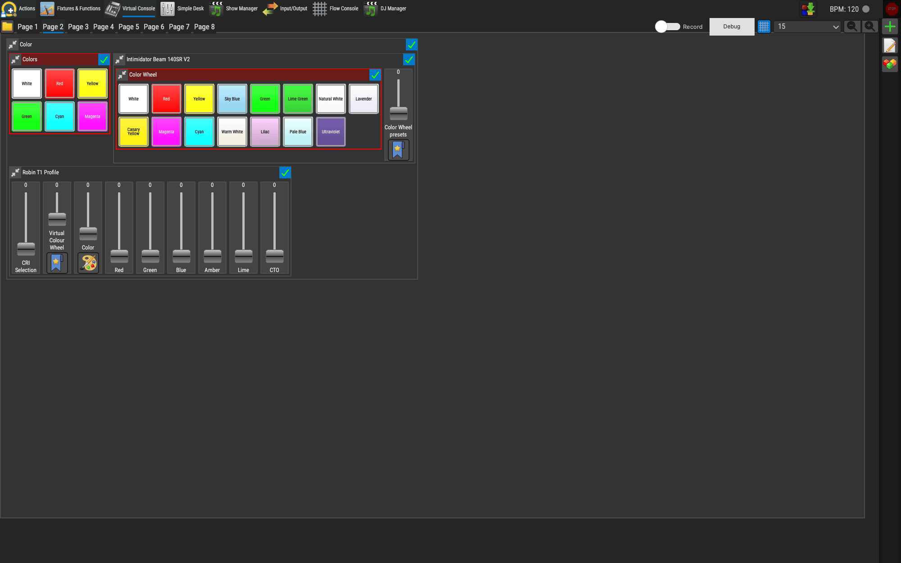</a> console page 2</td><td align="center" valign="top"><a href="images/page-planner/g2-engine-gaps-gobo-mix-3.png">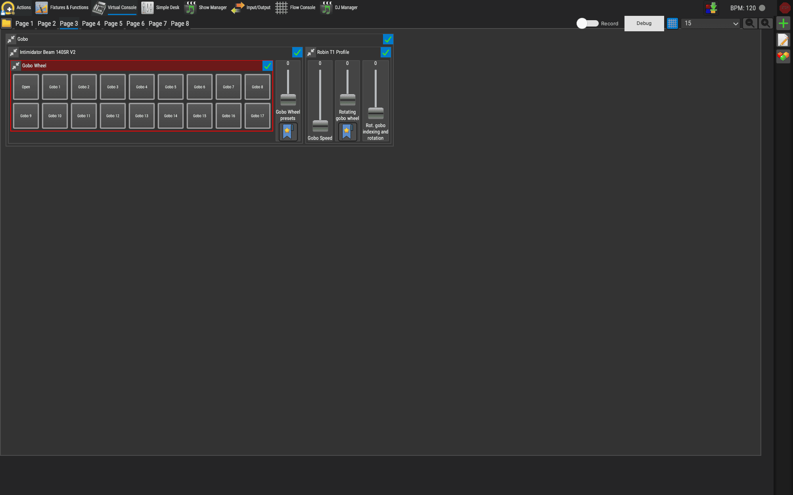</a> console page 3</td></tr>
<tr><td align="center" valign="top"><a href="images/page-planner/g2-engine-gaps-gobo-mix-4.png">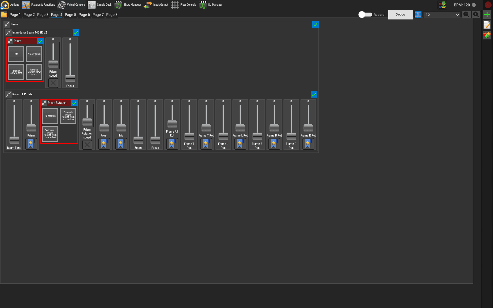</a> console page 4</td><td align="center" valign="top"><a href="images/page-planner/g2-engine-gaps-gobo-mix-5.png">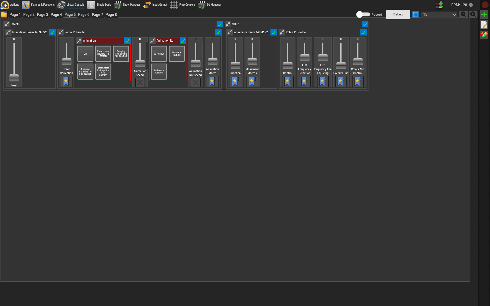</a> console page 5</td></tr>
</table>

Plan and measurements (text)
<pre># Gobo mix
## Intensity
- Dimmer [Intensity/Dimmer, Fader, 3 ch, 0 heads, 0 choices]
- Shutter [Shutter/Choices, Presets, 0 ch, 0 heads, 5 choices]
- Shutter speed [Shutter#1/rate, Fader, 2 ch, 0 heads, 0 choices]
### Intimidator Beam 140SR V2
- Shutter [Shutter#1/buttons, Presets, 0 ch, 0 heads, 7 choices]
### Robin T1 Profile
- Shutter [Shutter#1/buttons, Presets, 0 ch, 0 heads, 6 choices]
## Position
- Position [Position, PanTilt, 8 ch, 2 heads, 0 choices]
### Intimidator Beam 140SR V2
- Pan/Tilt Speed [Speed/SpeedPanTilt, Fader, 1 ch, 0 heads, 0 choices]
### Robin T1 Profile
- P/T Speed, P/T Time [Speed/p/t speed, p/t time, Fader, 1 ch, 0 heads, 0 choices]
## Color
- Colors [Color/Choices, Presets, 0 ch, 0 heads, 6 choices]
### Intimidator Beam 140SR V2
- Color Wheel [Colour#1/buttons, Presets, 0 ch, 0 heads, 15 choices]
- Color Wheel presets [Colour#1, Presets, 1 ch, 0 heads, 0 choices]
### Robin T1 Profile
- CRI Selection [Colour#1, Fader, 1 ch, 0 heads, 0 choices]
- Virtual Colour Wheel [Colour#2, Presets, 1 ch, 0 heads, 0 choices]
- Color [Color, ColorMixer, 10 ch, 0 heads, 0 choices]
- Red [Color/Red, Fader, 2 ch, 0 heads, 0 choices]
- Green [Color/Green, Fader, 2 ch, 0 heads, 0 choices]
- Blue [Color/Blue, Fader, 2 ch, 0 heads, 0 choices]
- Amber [Color/Amber, Fader, 2 ch, 0 heads, 0 choices]
- Lime [Color/Lime, Fader, 2 ch, 0 heads, 0 choices]
- CTO [Colour/ColorCTOMixer, Fader, 1 ch, 0 heads, 0 choices]
## Gobo
### Intimidator Beam 140SR V2
- Gobo Wheel [Gobo#1/buttons, Presets, 0 ch, 0 heads, 18 choices]
- Gobo Wheel presets [Gobo#1, Presets, 1 ch, 0 heads, 0 choices]
### Robin T1 Profile
- Gobo Speed [Speed/gobo speed, Fader, 1 ch, 0 heads, 0 choices]
- Rotating gobo wheel [Gobo#1, Presets, 1 ch, 0 heads, 0 choices]
- Rot. gobo indexing and rotation [Gobo#2, Fader, 2 ch, 0 heads, 0 choices]
## Beam
### Intimidator Beam 140SR V2
- Prism [Prism#1/buttons, Presets, 0 ch, 0 heads, 4 choices]
- Prism speed [Prism#1/rate, Fader, 1 ch, 0 heads, 0 choices]
- Focus [Beam/BeamFocus, Fader, 1 ch, 0 heads, 0 choices]
### Robin T1 Profile
- Beam Time [Speed/beam time, Fader, 1 ch, 0 heads, 0 choices]
- Prism [Prism#1, Presets, 1 ch, 0 heads, 0 choices]
- Prism Rotation [Prism#2/buttons, Presets, 0 ch, 0 heads, 3 choices]
- Prism Rotation speed [Prism#2/rate, Fader, 1 ch, 0 heads, 0 choices]
- Frost [Beam/frost, Presets, 1 ch, 0 heads, 0 choices]
- Iris [Beam/iris, Presets, 2 ch, 0 heads, 0 choices]
- Zoom [Beam/zoom, Fader, 2 ch, 0 heads, 0 choices]
- Focus [Beam/focus, Fader, 2 ch, 0 heads, 0 choices]
- Frame All Rot [Beam/frame all rot, Presets, 1 ch, 0 heads, 0 choices]
- Frame T Pos [Beam/frame t pos, Fader, 1 ch, 0 heads, 0 choices]
- Frame T Rot [Beam/frame t rot, Presets, 1 ch, 0 heads, 0 choices]
- Frame L Pos [Beam/frame l pos, Fader, 1 ch, 0 heads, 0 choices]
- Frame L Rot [Beam/frame l rot, Presets, 1 ch, 0 heads, 0 choices]
- Frame B Pos [Beam/frame b pos, Fader, 1 ch, 0 heads, 0 choices]
- Frame B Rot [Beam/frame b rot, Presets, 1 ch, 0 heads, 0 choices]
- Frame R Pos [Beam/frame r pos, Fader, 1 ch, 0 heads, 0 choices]
- Frame R Rot [Beam/frame r rot, Presets, 1 ch, 0 heads, 0 choices]
## Effects
### Intimidator Beam 140SR V2
- Frost [Effect/frost, Fader, 1 ch, 0 heads, 0 choices]
### Robin T1 Profile
- Green Correction [Effect/green correction, Presets, 1 ch, 0 heads, 0 choices]
- Animation [Effect/animation/buttons, Presets, 0 ch, 0 heads, 5 choices]
- Animation speed [Effect/animation/rate, Fader, 1 ch, 0 heads, 0 choices]
- Animation Rot [Effect/animation rot/buttons, Presets, 0 ch, 0 heads, 3 choices]
- Animation Rot speed [Effect/animation rot/rate, Fader, 1 ch, 0 heads, 0 choices]
- Animation Macro [Effect/animation macro, Presets, 1 ch, 0 heads, 0 choices]
## Setup
### Intimidator Beam 140SR V2
- Function [Maintenance/function, Presets, 1 ch, 0 heads, 0 choices]
- Movement Macros [Maintenance/movement macros, Presets, 1 ch, 0 heads, 0 choices]
### Robin T1 Profile
- Control [Maintenance/control, Presets, 1 ch, 0 heads, 0 choices]
- LED Frequency Selection [Maintenance/led frequency selection, Presets, 1 ch, 0 heads, 0 choices]
- LED frequency fine adjusting [Maintenance/led frequency fine adjusting, Presets, 1 ch, 0 heads, 0 choices]
- Colour Func [Maintenance/colour func, Presets, 1 ch, 0 heads, 0 choices]
- Colour Mix Control [Maintenance/colour mix control, Presets, 1 ch, 0 heads, 0 choices]</pre>

## Console page action (`consolePageAction`)

The "make console pages" action from the fixture list, one shot per page it creates.

### One beam: one console page.

<table>
<tr><td align="center" valign="top"><a href="images/page-planner/one-fixture-1.png">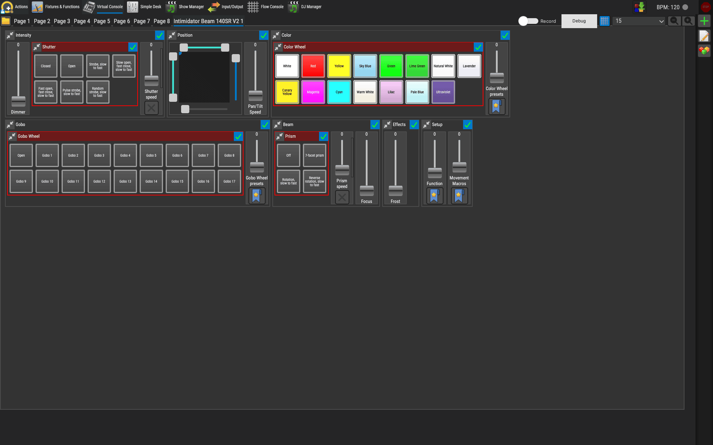</a> console page 1</td></tr>
</table>

### Four different fixtures: a group page, then one page per model.

<table>
<tr><td align="center" valign="top"><a href="images/page-planner/mixed-group-1.png">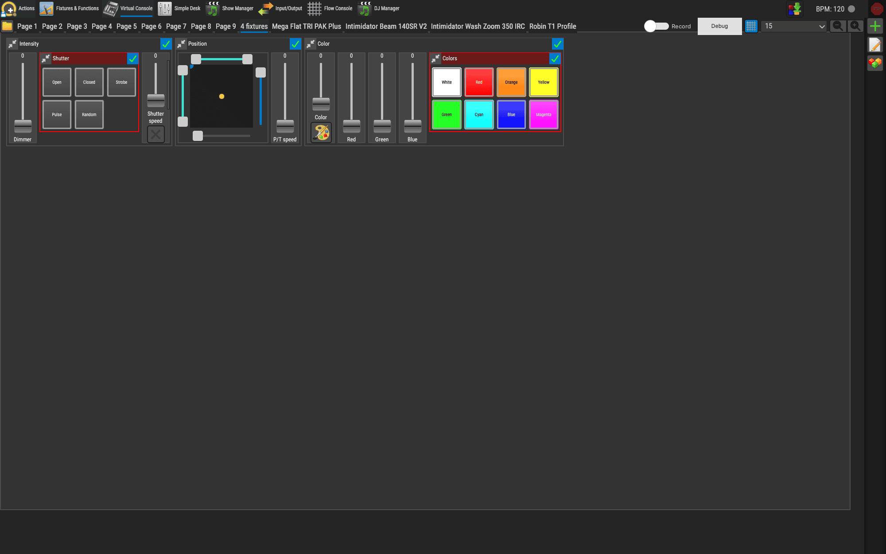</a> console page 1</td><td align="center" valign="top"><a href="images/page-planner/mixed-group-2.png">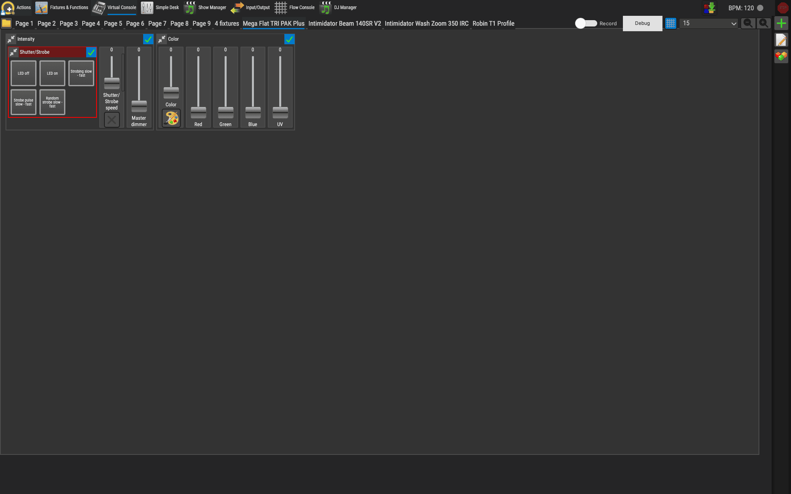</a> console page 2</td><td align="center" valign="top"><a href="images/page-planner/mixed-group-3.png">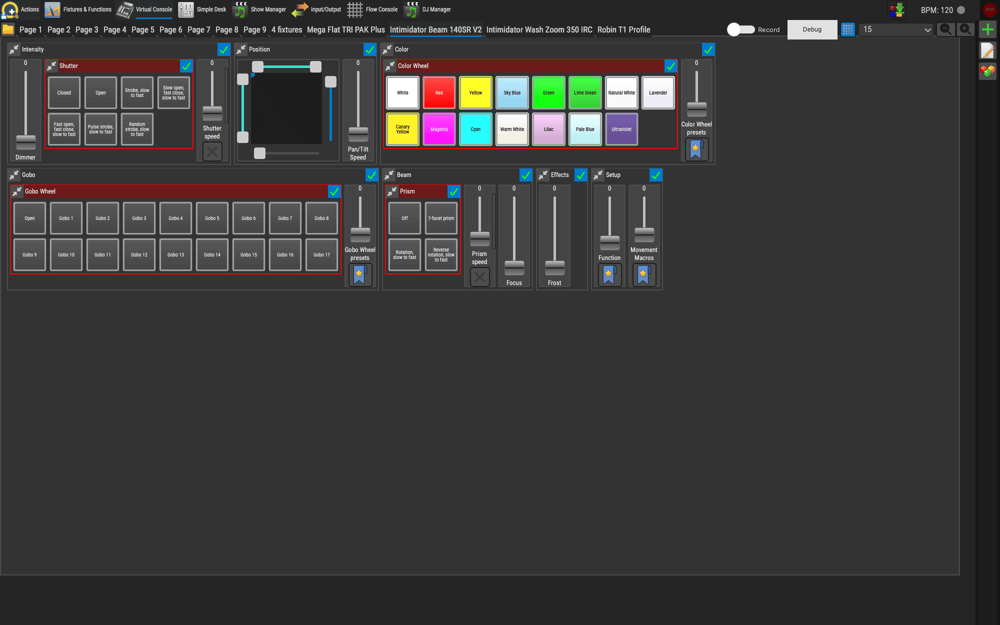</a> console page 3</td></tr>
<tr><td align="center" valign="top"><a href="images/page-planner/mixed-group-4.png">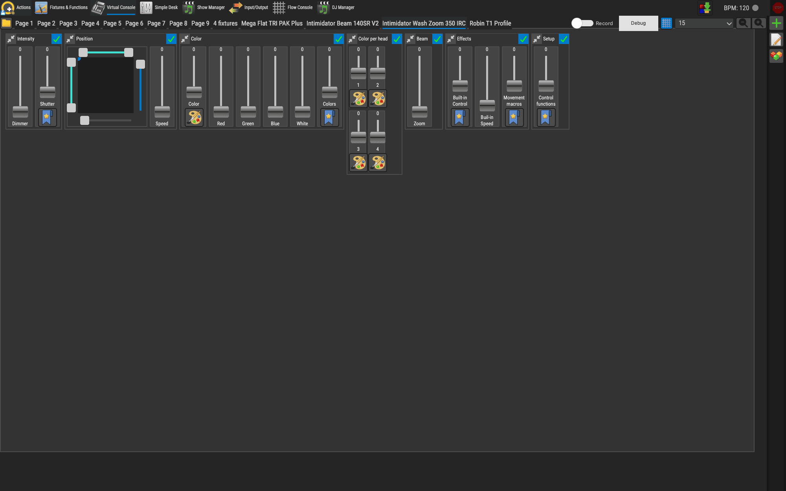</a> console page 4</td><td align="center" valign="top"><a href="images/page-planner/mixed-group-5.png">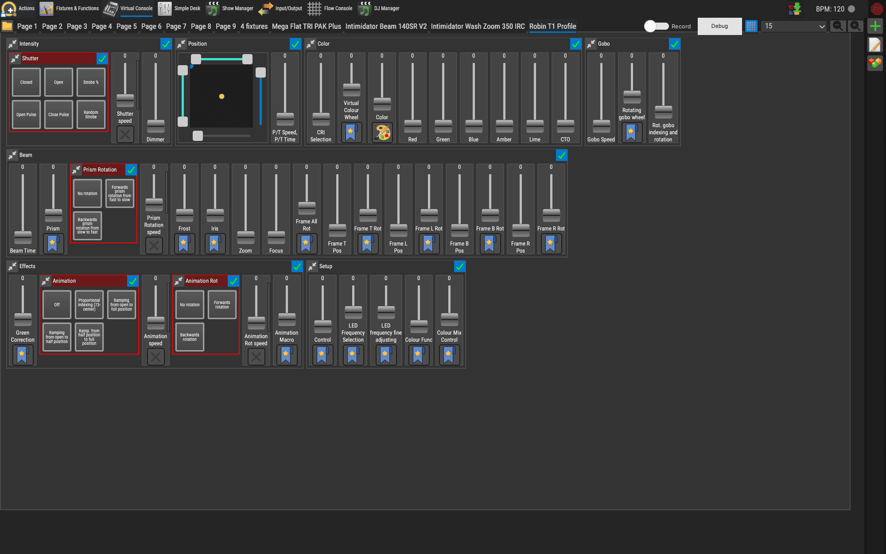</a> console page 5</td></tr>
</table>

### One profile in a 1300x800 window: sections that do not fit move to the next page.

<table>
<tr><td align="center" valign="top"> console page 1</td><td align="center" valign="top"> console page 2</td><td align="center" valign="top"> console page 3</td></tr>
</table>

## Functions run from the page (`functionsRun`)

A page is built for one fixture, then the test presses a control and checks the channel values. Left: the built page. Right: after the press.

<table>
<tr><th></th><th>Built page</th><th>After the press</th></tr>
<tr><td valign="top">Beam: press "Open" (Shutter)</td><td align="center" valign="top"></td><td align="center" valign="top"></td></tr>
<tr><td valign="top">Beam: press "7-facet prism" (Prism)</td><td align="center" valign="top"></td><td align="center" valign="top"></td></tr>
<tr><td valign="top">Beam: press "Red" (Color Wheel)</td><td align="center" valign="top"></td><td align="center" valign="top"></td></tr>
<tr><td valign="top">Strobe: press the flash button</td><td align="center" valign="top"><a href="images/page-planner/run-strobe-flash.png">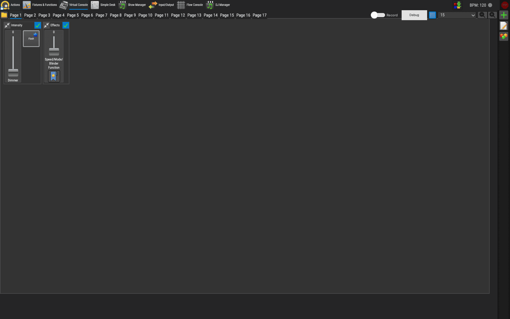</a></td><td align="center" valign="top"><a href="images/page-planner/run-strobe-flash-on.png">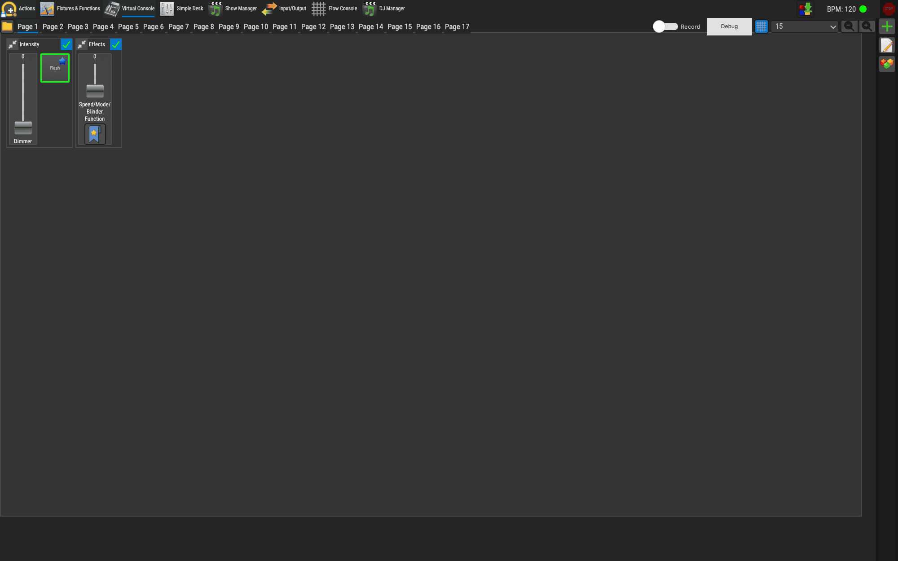</a></td></tr>
<tr><td valign="top">Pixel bar: start the matrix animation</td><td align="center" valign="top"><a href="images/page-planner/run-pixel-matrix.png">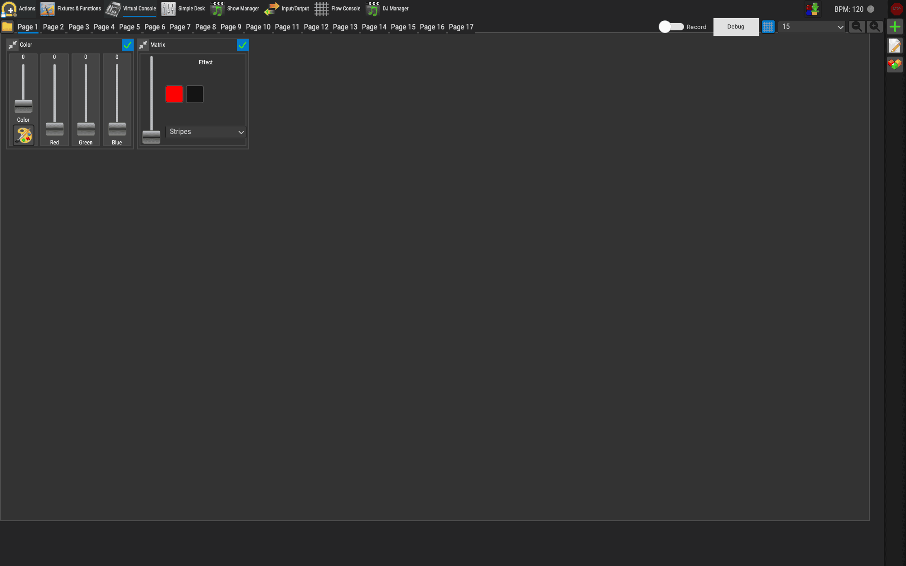</a></td><td align="center" valign="top"><a href="images/page-planner/run-pixel-matrix-on.png">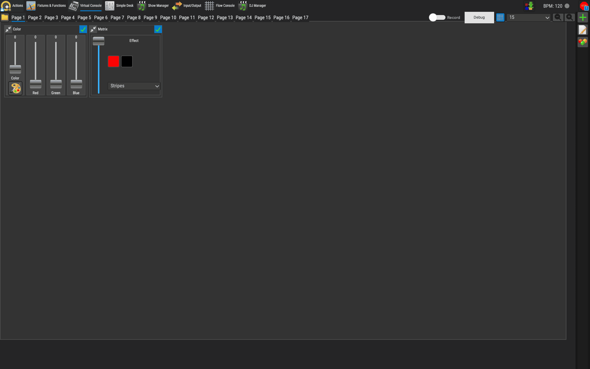</a></td></tr>
</table>
