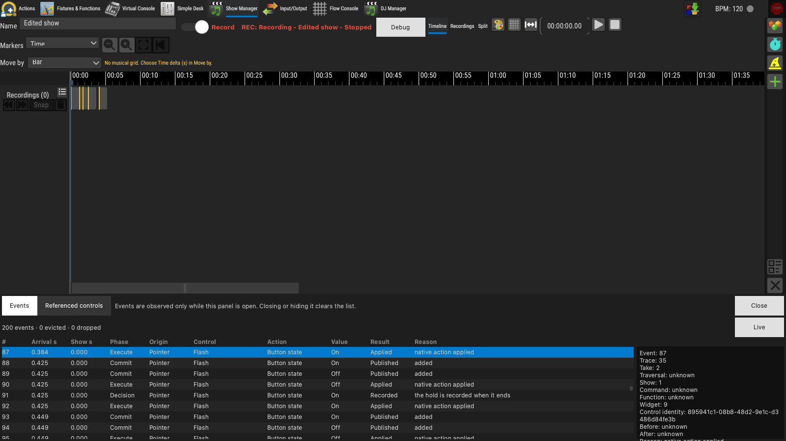
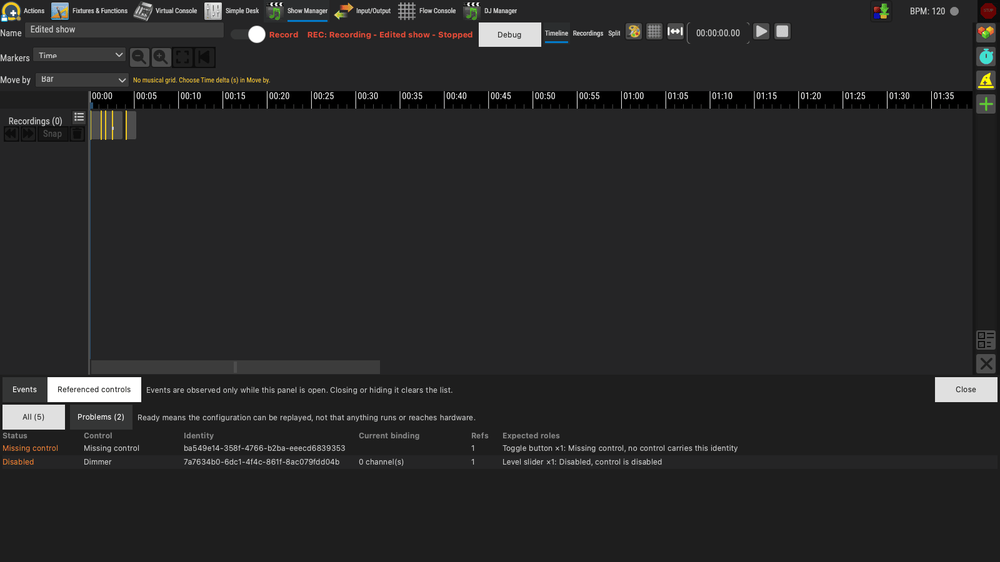
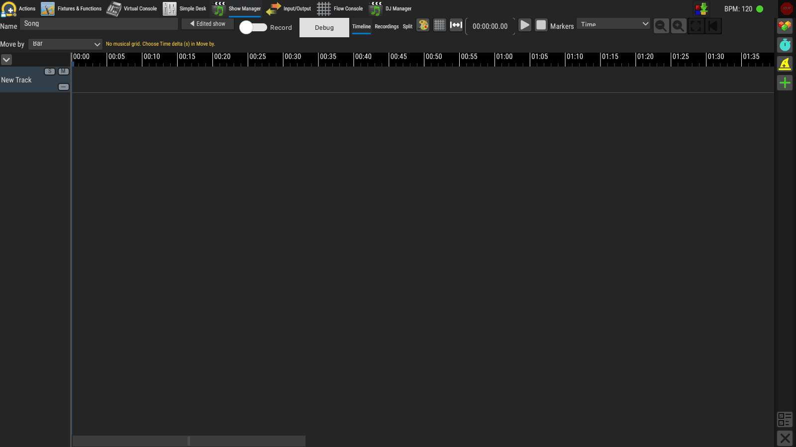
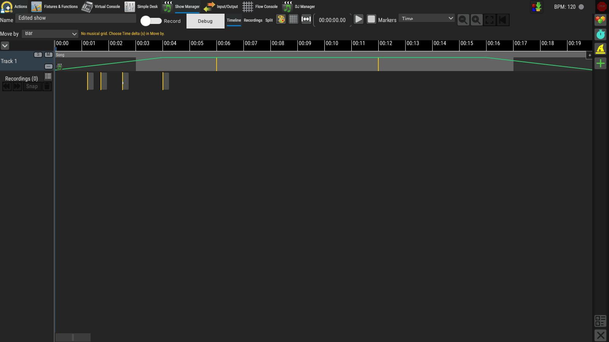
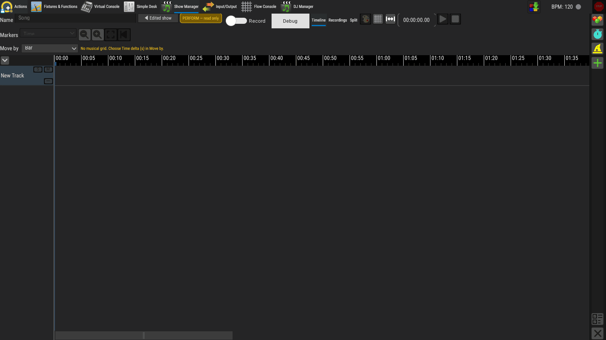

# Show recorder screenshots

[Back to the report](README.md)

The Show Manager's recorder. Window grabs from `showcommandrecorder_test`.

Click a thumbnail for the full-size image.

## Debug panel (`debugPanel_appReadingPositionAndProblems`)

The recorder's debug panel: the event list and the referenced controls.

<table>
<tr><td align="center" valign="top"> Events tab</td><td align="center" valign="top"> Referenced controls tab</td></tr>
</table>

## Nested show opens and goes back (`timeline_nestedShowOpensAndGoesBack`)

A set with a song clip; a double-click opens the song's own Show with a back button to the set.

<table>
<tr><th></th><th>Set with the song clip</th><th>Song opened</th></tr>
<tr><td valign="top">Back button</td><td align="center" valign="top"></td><td align="center" valign="top"></td></tr>
<tr><td valign="top">Another show forgets the way back</td><td align="center" valign="top"></td><td align="center" valign="top"></td></tr>
<tr><td valign="top">Read-only (Perform) still navigates</td><td align="center" valign="top"></td><td align="center" valign="top"></td></tr>
</table>
