# VC editor screenshots

[Back to the report](README.md)

Virtual Console editing: undo, property panels, menus and messages. Window grabs from `vceditor_test`.

Click a thumbnail for the full-size image.

## Edit, then undo (`editUndoRedoRoundTrip`)

Each edit must be one undo step. The test builds the same console (an outer frame with two buttons and a nested frame, an empty frame, a loose button), applies one edit, then undoes it: the undone console must equal the one before, byte for byte. Redo is checked too, without a shot.

<table>
<tr><th></th><th>Before</th><th>After</th><th>Undone</th></tr>
<tr><td valign="top"><code>addPage</code> Add a console page</td><td align="center" valign="top"></td><td align="center" valign="top"></td><td align="center" valign="top"></td></tr>
<tr><td valign="top"><code>alignLeft</code> Align the loose button and the empty frame left</td><td align="center" valign="top"></td><td align="center" valign="top"></td><td align="center" valign="top"></td></tr>
<tr><td valign="top"><code>alignTop</code> Align the empty frame and the loose button to the top</td><td align="center" valign="top"></td><td align="center" valign="top"><a href="images/vc-editor/editundoredoroundtrip/aligntop-after.png">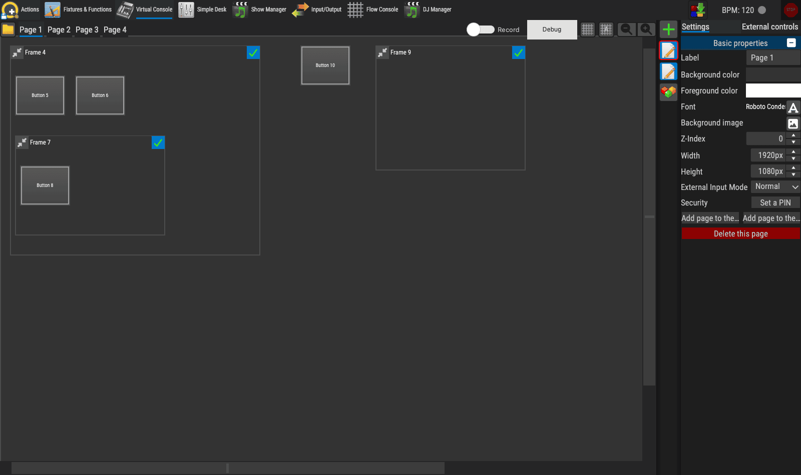</a></td><td align="center" valign="top"></td></tr>
<tr><td valign="top"><code>arrangeAndResize</code> Flow-arrange the outer frame and resize it, as one undo step</td><td align="center" valign="top"></td><td align="center" valign="top"><a href="images/vc-editor/editundoredoroundtrip/arrangeandresize-after.png">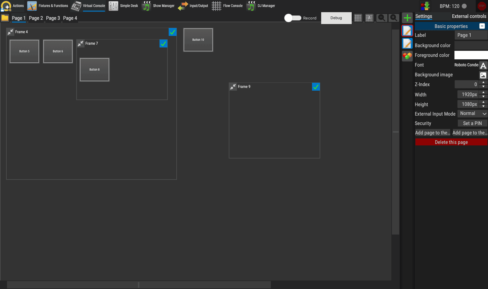</a></td><td align="center" valign="top"></td></tr>
<tr><td valign="top"><code>arrangeSettings</code> Arrange the empty frame as a 3-column grid</td><td align="center" valign="top"></td><td align="center" valign="top"></td><td align="center" valign="top"></td></tr>
<tr><td valign="top"><code>arrangedCreate</code> Flow-arrange the outer frame, then create a button in it</td><td align="center" valign="top"></td><td align="center" valign="top"><a href="images/vc-editor/editundoredoroundtrip/arrangedcreate-after.png">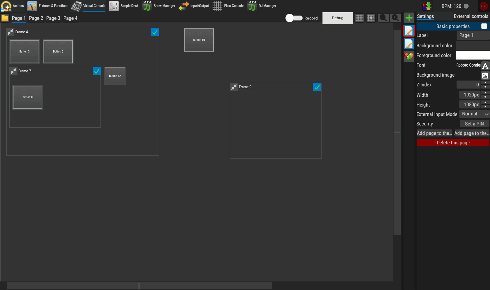</a></td><td align="center" valign="top"></td></tr>
<tr><td valign="top"><code>arrangedMoveOut</code> Flow-arrange the outer frame, then drop a button out of it</td><td align="center" valign="top"></td><td align="center" valign="top"><a href="images/vc-editor/editundoredoroundtrip/arrangedmoveout-after.png">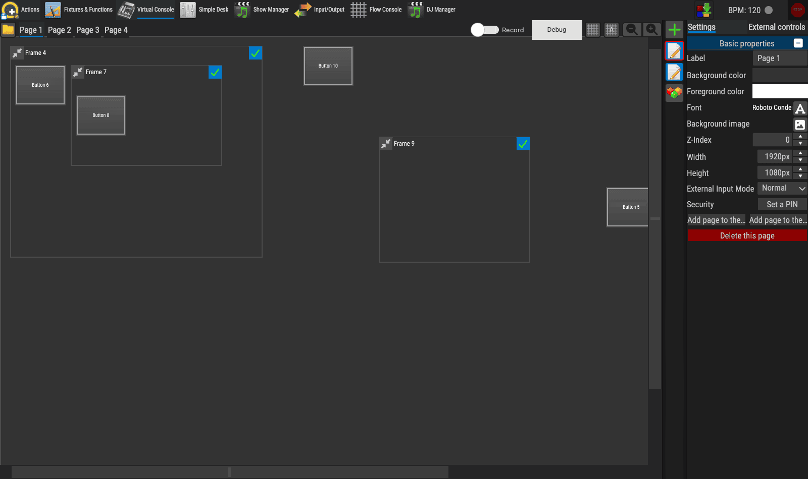</a></td><td align="center" valign="top"></td></tr>
<tr><td valign="top"><code>background</code> Give two buttons a red background</td><td align="center" valign="top"></td><td align="center" valign="top"><a href="images/vc-editor/editundoredoroundtrip/background-after.png">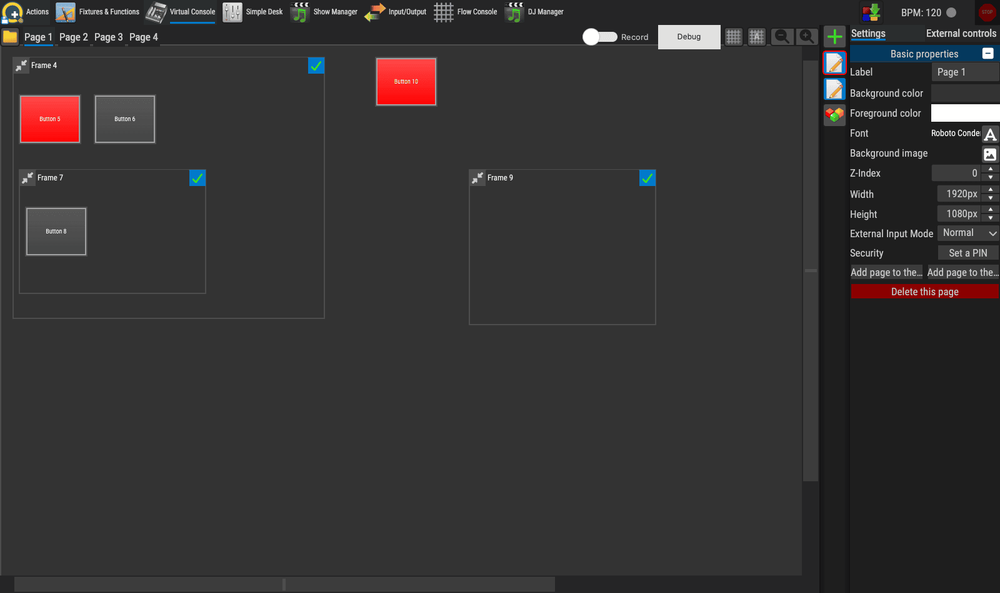</a></td><td align="center" valign="top"></td></tr>
<tr><td valign="top"><code>buttonMatrix</code> Add a 2x2 button matrix</td><td align="center" valign="top"></td><td align="center" valign="top"><a href="images/vc-editor/editundoredoroundtrip/buttonmatrix-after.png">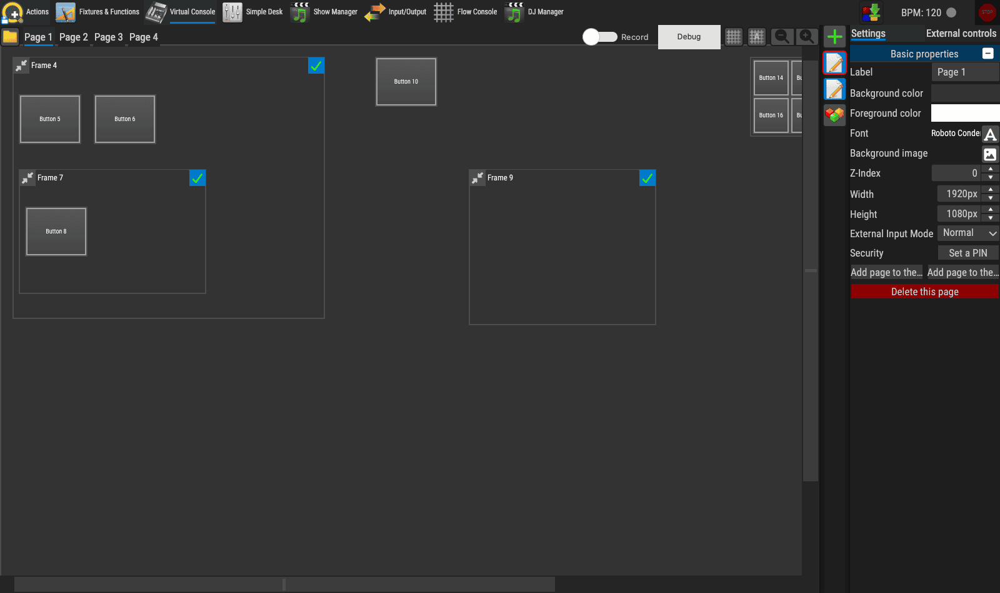</a></td><td align="center" valign="top"></td></tr>
<tr><td valign="top"><code>caption</code> Rename the loose button</td><td align="center" valign="top"></td><td align="center" valign="top"><a href="images/vc-editor/editundoredoroundtrip/caption-after.png">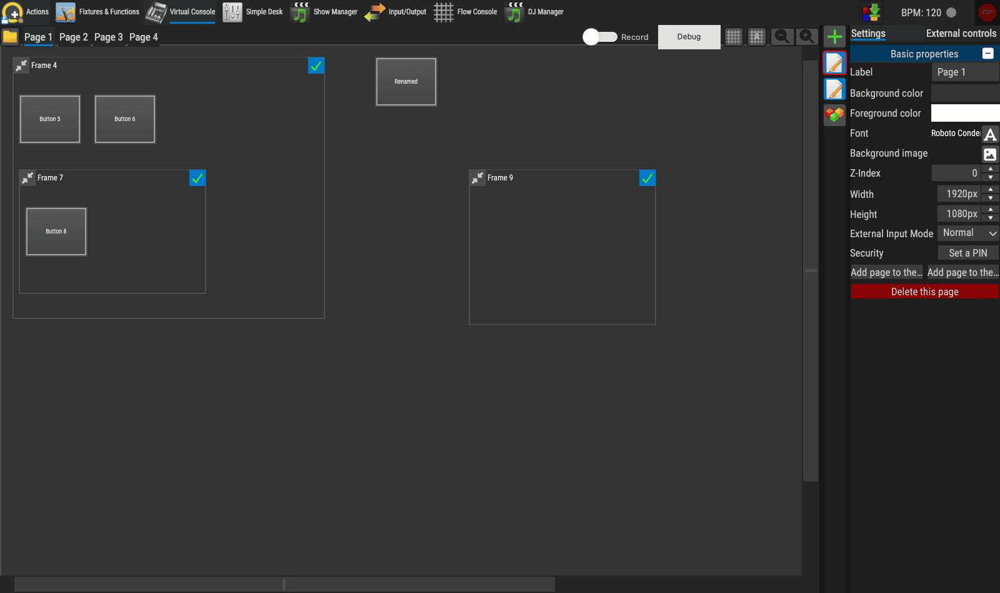</a></td><td align="center" valign="top"></td></tr>
<tr><td valign="top"><code>cloneFirstPage</code> Give the outer frame 2 pages and clone the first</td><td align="center" valign="top"></td><td align="center" valign="top"><a href="images/vc-editor/editundoredoroundtrip/clonefirstpage-after.png">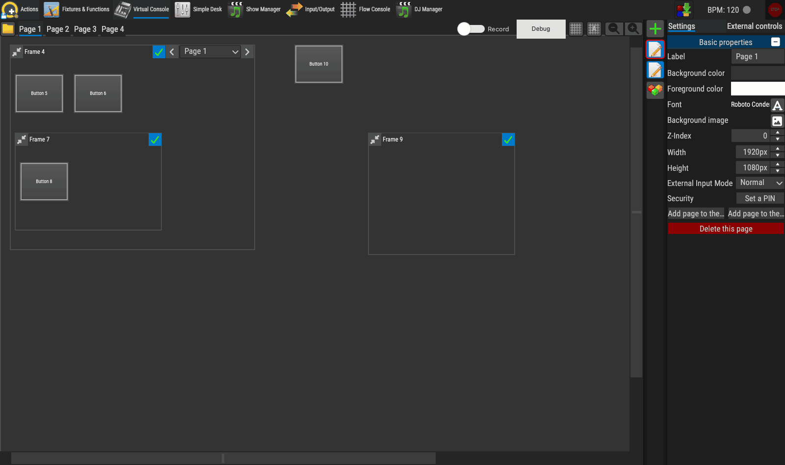</a></td><td align="center" valign="top"></td></tr>
<tr><td valign="top"><code>collapse</code> Collapse the outer frame</td><td align="center" valign="top"></td><td align="center" valign="top"><a href="images/vc-editor/editundoredoroundtrip/collapse-after.png">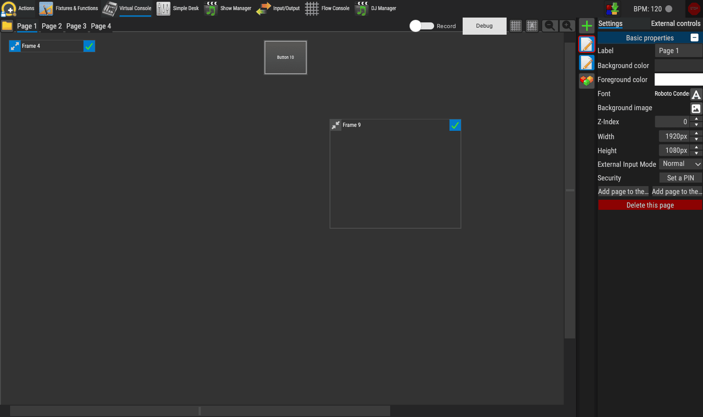</a></td><td align="center" valign="top"></td></tr>
<tr><td valign="top"><code>confirmLayout</code> Confirm a layout preview of the outer frame</td><td align="center" valign="top"></td><td align="center" valign="top"><a href="images/vc-editor/editundoredoroundtrip/confirmlayout-after.png">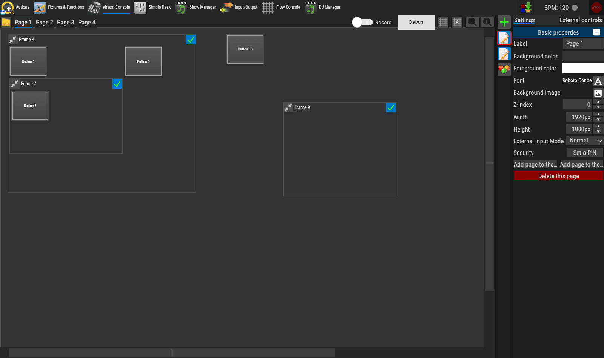</a></td><td align="center" valign="top"></td></tr>
<tr><td valign="top"><code>create</code> Create a button on the page</td><td align="center" valign="top"></td><td align="center" valign="top"></td><td align="center" valign="top"></td></tr>
<tr><td valign="top"><code>createInFrame</code> Create a slider in the empty frame</td><td align="center" valign="top"></td><td align="center" valign="top"><a href="images/vc-editor/editundoredoroundtrip/createinframe-after.png">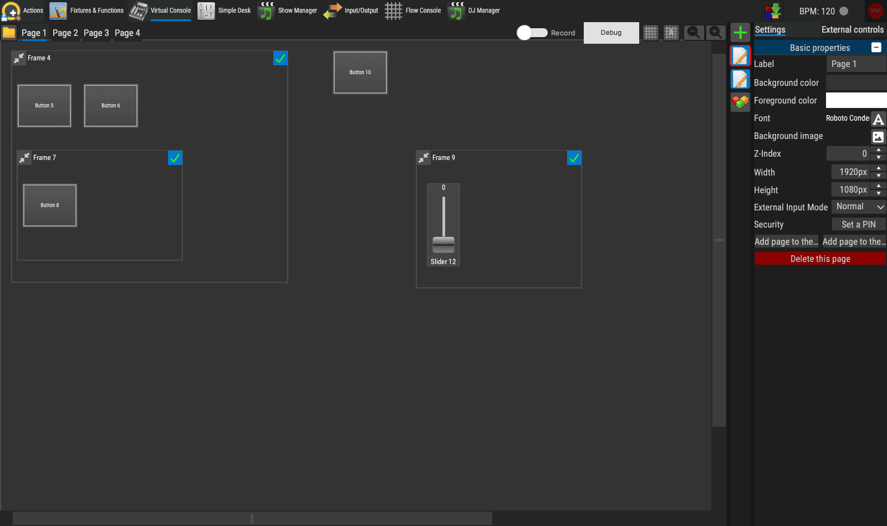</a></td><td align="center" valign="top"></td></tr>
<tr><td valign="top"><code>cutPaste</code> Cut the loose button and paste it into the empty frame</td><td align="center" valign="top"></td><td align="center" valign="top"><a href="images/vc-editor/editundoredoroundtrip/cutpaste-after.png">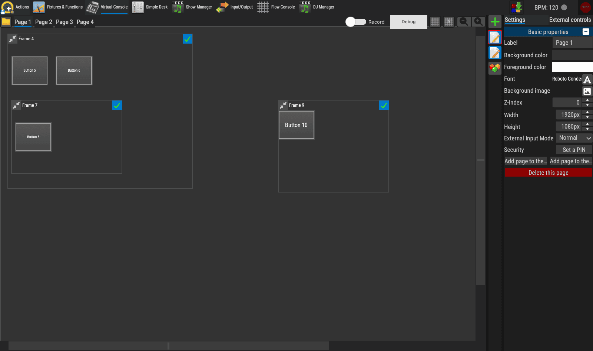</a></td><td align="center" valign="top"></td></tr>
<tr><td valign="top"><code>deleteButton</code> Delete the loose button</td><td align="center" valign="top"></td><td align="center" valign="top"><a href="images/vc-editor/editundoredoroundtrip/deletebutton-after.png">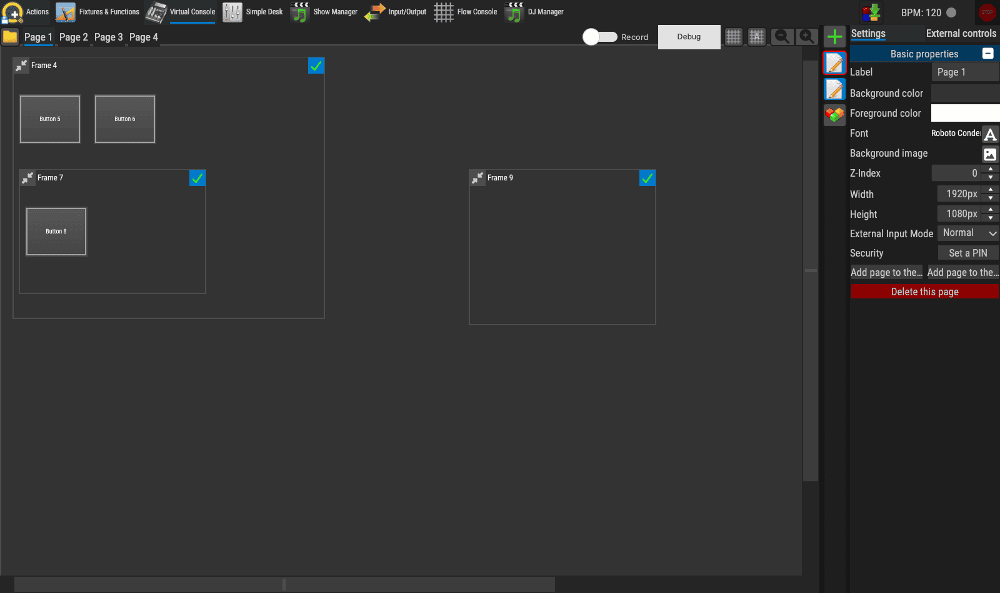</a></td><td align="center" valign="top"></td></tr>
<tr><td valign="top"><code>deleteFilledPage</code> Delete page 2, which holds a button</td><td align="center" valign="top"></td><td align="center" valign="top"></td><td align="center" valign="top"><a href="images/vc-editor/editundoredoroundtrip/deletefilledpage-undone.png">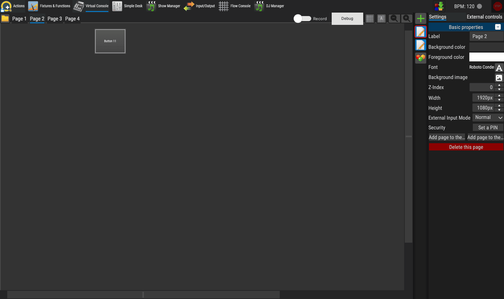</a></td></tr>
<tr><td valign="top"><code>deleteFirstChild</code> Delete the first button in the outer frame</td><td align="center" valign="top"></td><td align="center" valign="top"><a href="images/vc-editor/editundoredoroundtrip/deletefirstchild-after.png">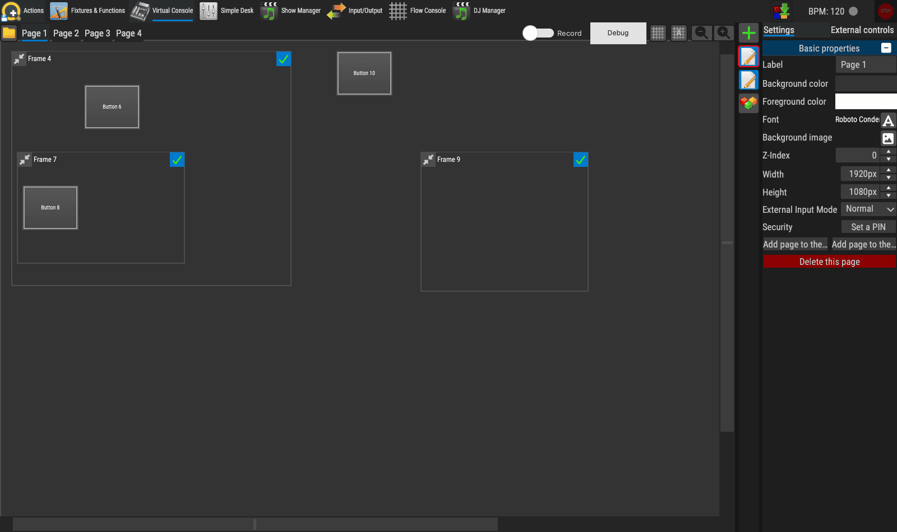</a></td><td align="center" valign="top"></td></tr>
<tr><td valign="top"><code>deleteFrame</code> Delete the outer frame with its children</td><td align="center" valign="top"></td><td align="center" valign="top"></td><td align="center" valign="top"></td></tr>
<tr><td valign="top"><code>deleteNestedFrame</code> Delete the nested frame</td><td align="center" valign="top"></td><td align="center" valign="top"><a href="images/vc-editor/editundoredoroundtrip/deletenestedframe-after.png">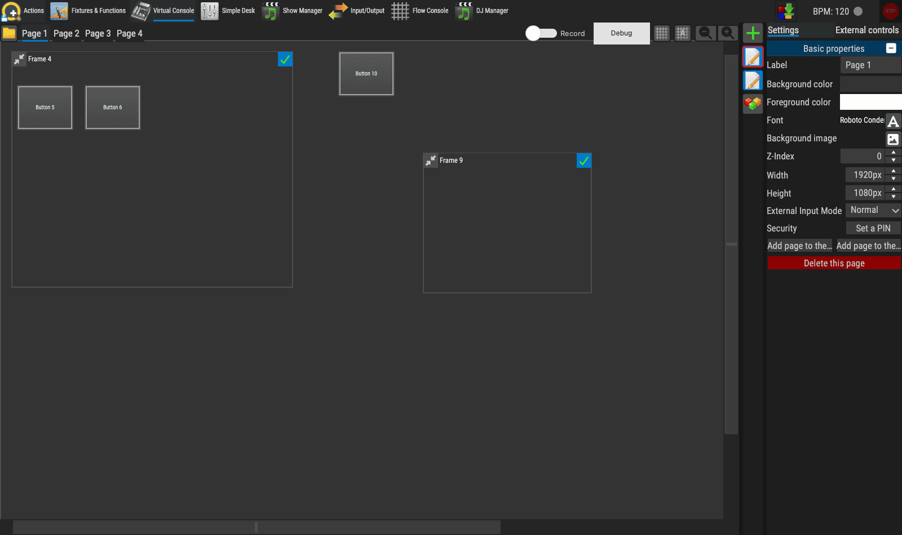</a></td><td align="center" valign="top"></td></tr>
<tr><td valign="top"><code>deletePage</code> Delete the empty last page</td><td align="center" valign="top"></td><td align="center" valign="top"></td><td align="center" valign="top"><a href="images/vc-editor/editundoredoroundtrip/deletepage-undone.png">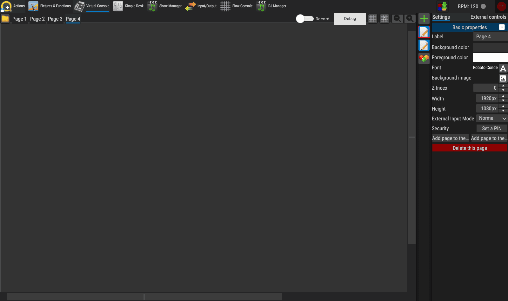</a></td></tr>
<tr><td valign="top"><code>deleteSelection</code> Delete two selected buttons</td><td align="center" valign="top"></td><td align="center" valign="top"><a href="images/vc-editor/editundoredoroundtrip/deleteselection-after.png">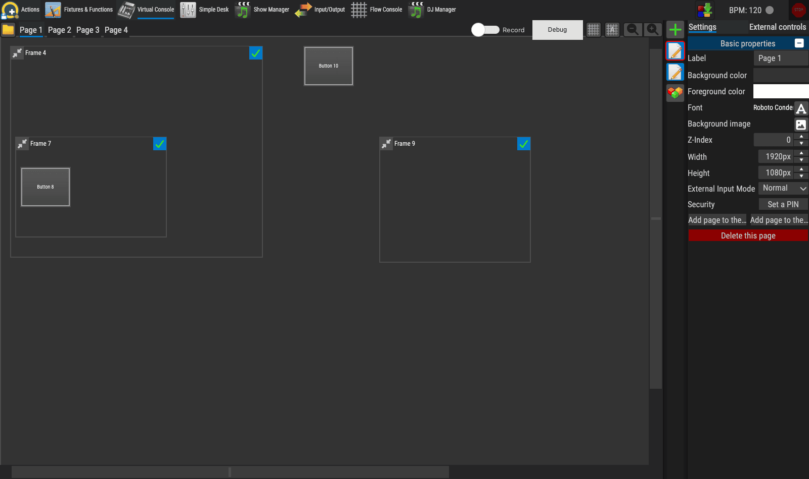</a></td><td align="center" valign="top"></td></tr>
<tr><td valign="top"><code>disableFrame</code> Disable the outer frame</td><td align="center" valign="top"></td><td align="center" valign="top"><a href="images/vc-editor/editundoredoroundtrip/disableframe-after.png">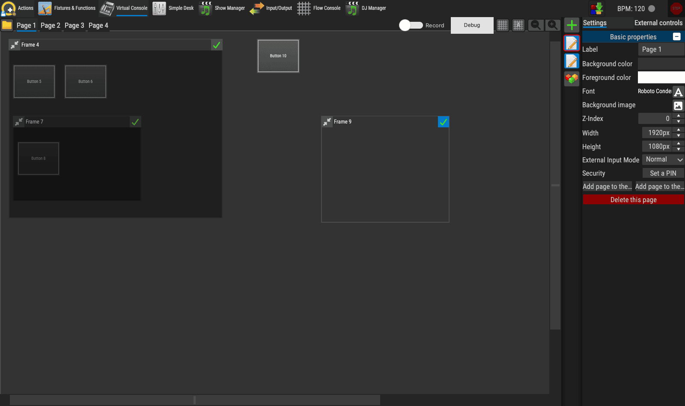</a></td><td align="center" valign="top"></td></tr>
<tr><td valign="top"><code>distribute</code> Distribute three widgets horizontally</td><td align="center" valign="top"></td><td align="center" valign="top"></td><td align="center" valign="top"></td></tr>
<tr><td valign="top"><code>dropIntoFrame</code> Drop the loose button into the empty frame</td><td align="center" valign="top"></td><td align="center" valign="top"><a href="images/vc-editor/editundoredoroundtrip/dropintoframe-after.png">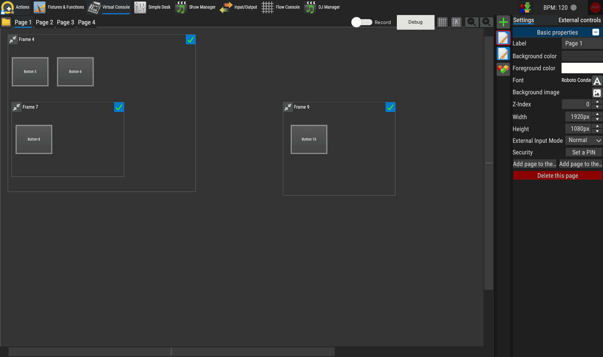</a></td><td align="center" valign="top"></td></tr>
<tr><td valign="top"><code>dropOutOfFrame</code> Drop a button out of the outer frame onto the page</td><td align="center" valign="top"></td><td align="center" valign="top"><a href="images/vc-editor/editundoredoroundtrip/dropoutofframe-after.png">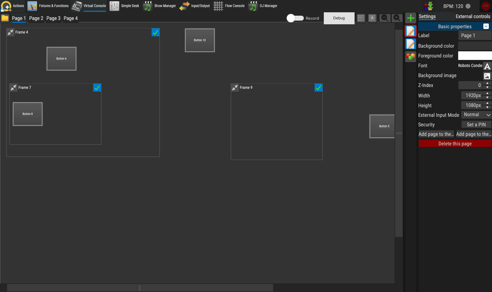</a></td><td align="center" valign="top"></td></tr>
<tr><td valign="top"><code>font</code> Set the loose button's font to Arial 20</td><td align="center" valign="top"></td><td align="center" valign="top"><a href="images/vc-editor/editundoredoroundtrip/font-after.png">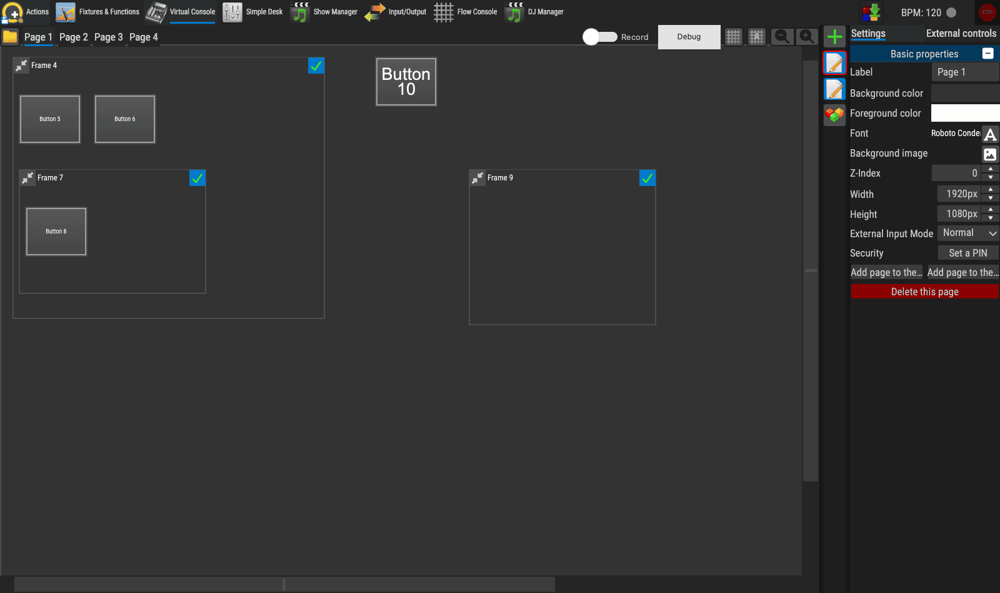</a></td><td align="center" valign="top"></td></tr>
<tr><td valign="top"><code>functionDrop</code> Drop a new scene onto the page</td><td align="center" valign="top"><a href="images/vc-editor/editundoredoroundtrip/functiondrop-before.png">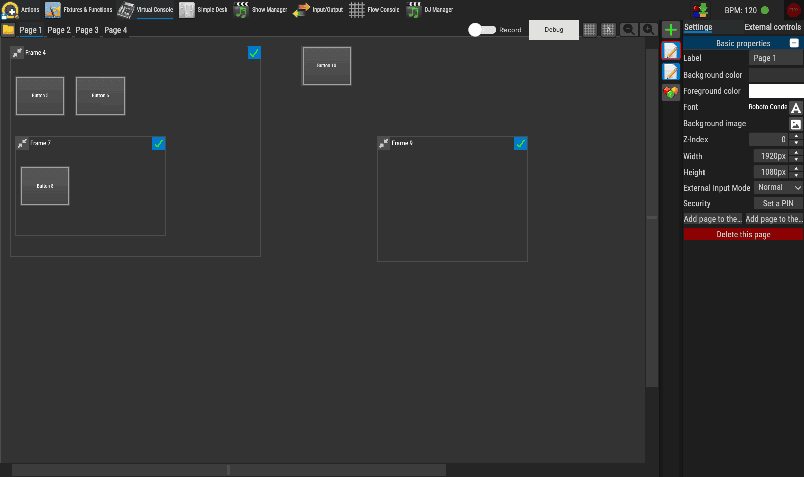</a></td><td align="center" valign="top"></td><td align="center" valign="top"></td></tr>
<tr><td valign="top"><code>hideEnableButton</code> Hide the outer frame's enable button</td><td align="center" valign="top"></td><td align="center" valign="top"><a href="images/vc-editor/editundoredoroundtrip/hideenablebutton-after.png">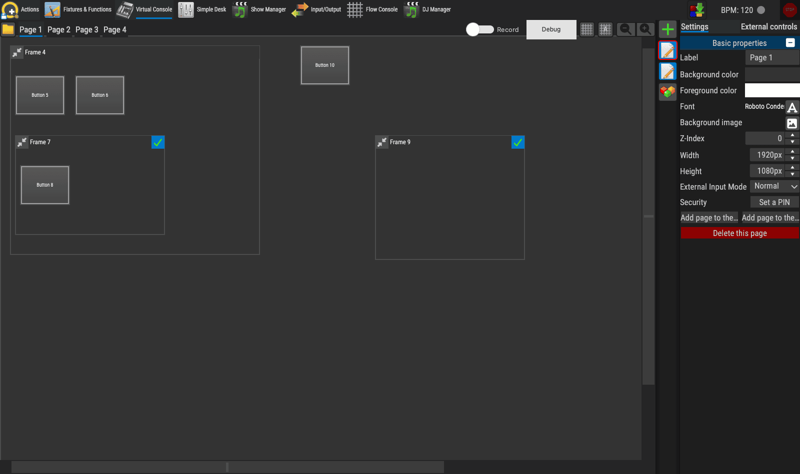</a></td><td align="center" valign="top"></td></tr>
<tr><td valign="top"><code>hideHeader</code> Hide the empty frame's header</td><td align="center" valign="top"></td><td align="center" valign="top"><a href="images/vc-editor/editundoredoroundtrip/hideheader-after.png">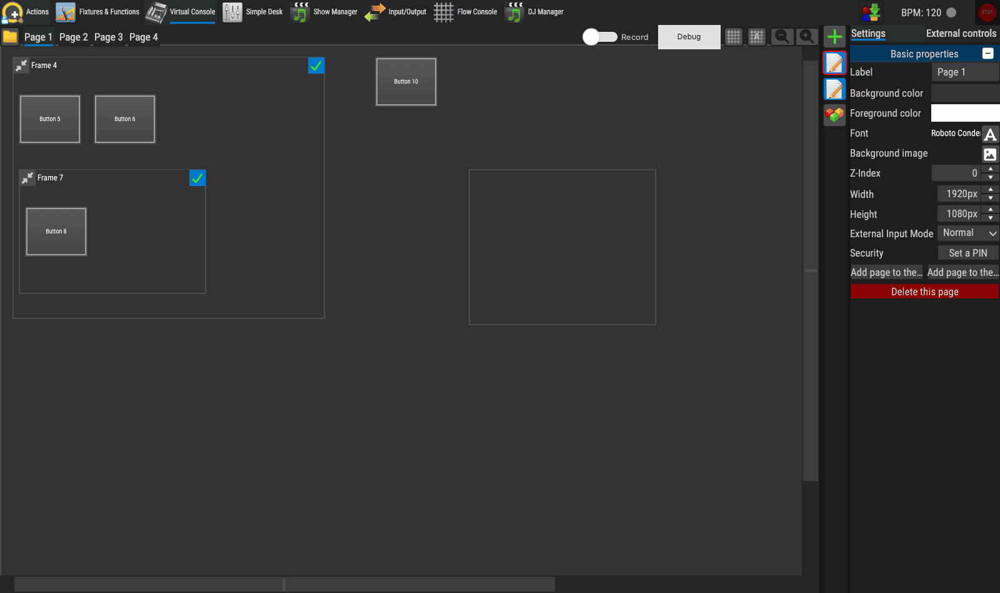</a></td><td align="center" valign="top"></td></tr>
<tr><td valign="top"><code>move</code> Move the loose button 100 px down</td><td align="center" valign="top"></td><td align="center" valign="top"><a href="images/vc-editor/editundoredoroundtrip/move-after.png">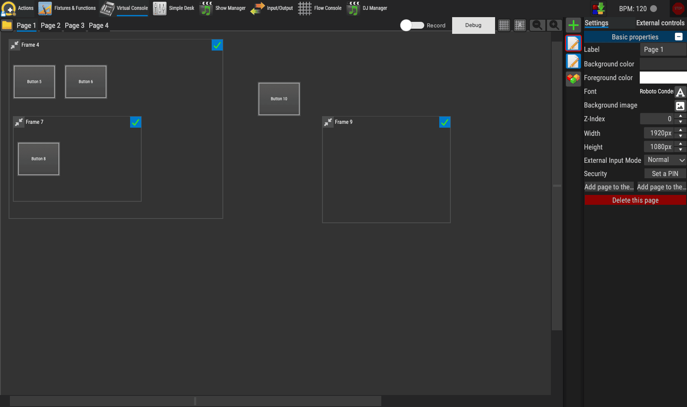</a></td><td align="center" valign="top"></td></tr>
<tr><td valign="top"><code>multiPage</code> Give the outer frame 3 pages</td><td align="center" valign="top"></td><td align="center" valign="top"></td><td align="center" valign="top"></td></tr>
<tr><td valign="top"><code>nudge</code> Nudge the loose button one step right</td><td align="center" valign="top"></td><td align="center" valign="top"></td><td align="center" valign="top"></td></tr>
<tr><td valign="top"><code>pagesLoop</code> Turn on page looping in the outer frame</td><td align="center" valign="top"></td><td align="center" valign="top"></td><td align="center" valign="top"></td></tr>
<tr><td valign="top"><code>paste</code> Copy the loose button and paste it into the empty frame</td><td align="center" valign="top"></td><td align="center" valign="top"><a href="images/vc-editor/editundoredoroundtrip/paste-after.png">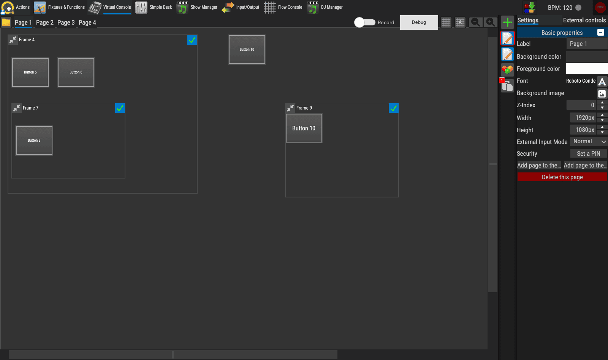</a></td><td align="center" valign="top"><a href="images/vc-editor/editundoredoroundtrip/paste-undone.png">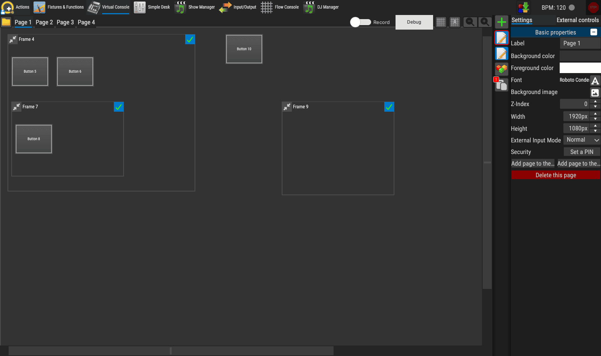</a></td></tr>
<tr><td valign="top"><code>reorder</code> Move a button to the front of its frame</td><td align="center" valign="top"></td><td align="center" valign="top"></td><td align="center" valign="top"></td></tr>
<tr><td valign="top"><code>resize</code> Resize the loose button</td><td align="center" valign="top"></td><td align="center" valign="top"><a href="images/vc-editor/editundoredoroundtrip/resize-after.png">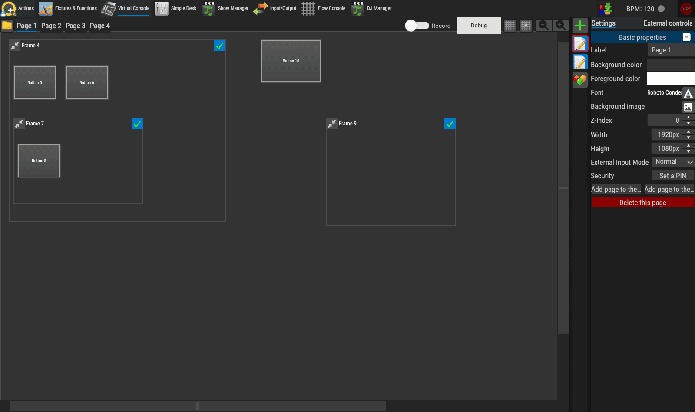</a></td><td align="center" valign="top"></td></tr>
<tr><td valign="top"><code>resizeFrame</code> Resize the outer frame</td><td align="center" valign="top"></td><td align="center" valign="top"></td><td align="center" valign="top"></td></tr>
<tr><td valign="top"><code>selectionDrop</code> Drop a two-button selection onto the page</td><td align="center" valign="top"></td><td align="center" valign="top"><a href="images/vc-editor/editundoredoroundtrip/selectiondrop-after.png">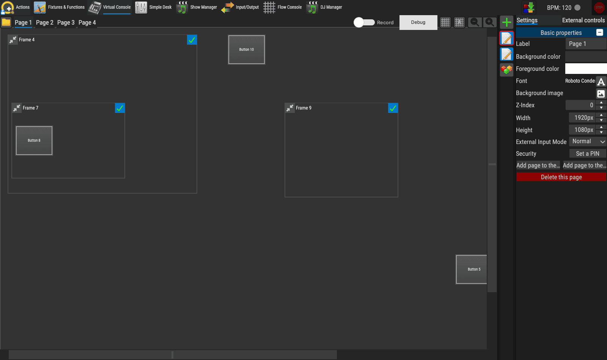</a></td><td align="center" valign="top"></td></tr>
<tr><td valign="top"><code>zIndex</code> Raise the loose button's z-index to 5</td><td align="center" valign="top"></td><td align="center" valign="top"></td><td align="center" valign="top"></td></tr>
</table>

## Geometry fields (`geometryFields`)

The property panel after one click on a field's up arrow. The fields show unzoomed sizes.

<table>
<tr><td align="center" valign="top"> X field</td><td align="center" valign="top"> Y field</td><td align="center" valign="top"> Width field</td></tr>
<tr><td align="center" valign="top"><a href="images/vc-editor/geometryfields/height-panel.png">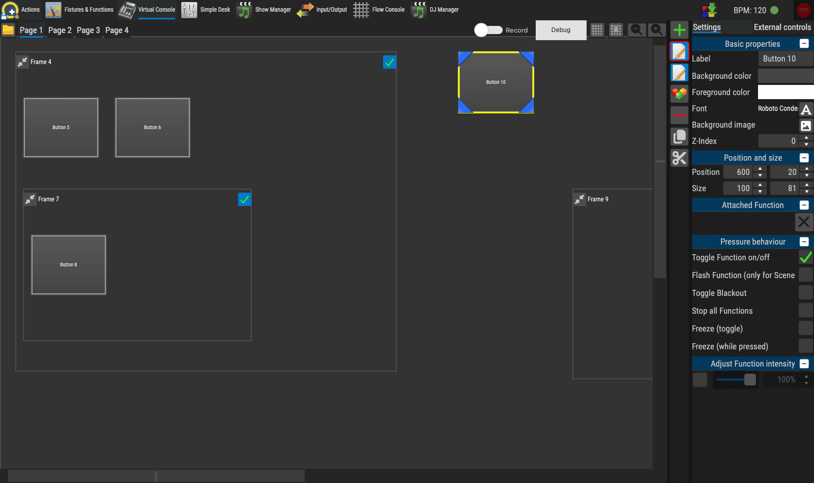</a> Height field</td><td align="center" valign="top"><a href="images/vc-editor/geometryfields/page-width-panel.png">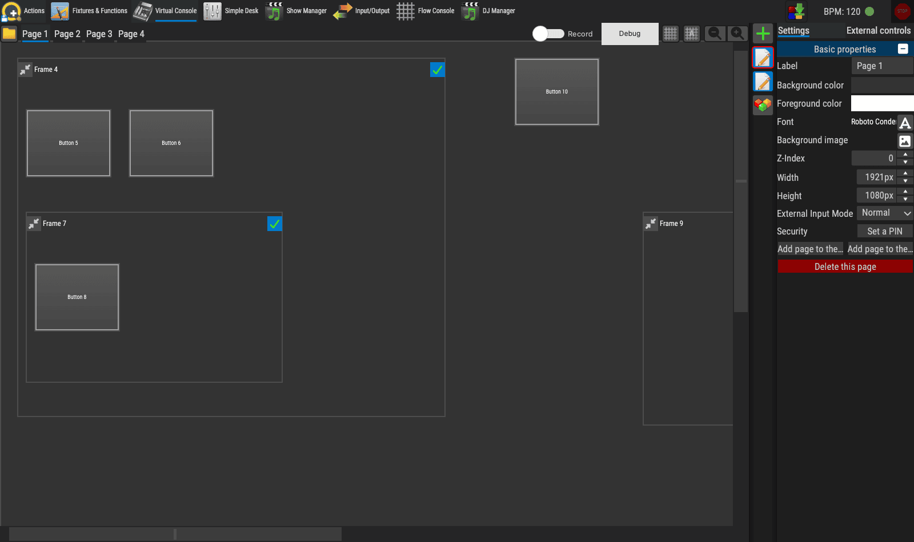</a> Page width field</td></tr>
</table>

## Widget menu (`widgetMenu`)

The right-click menu of a button, shot before the test clicks each entry.

<table>
<tr><td align="center" valign="top"><a href="images/vc-editor/widgetmenu/properties-menu.png">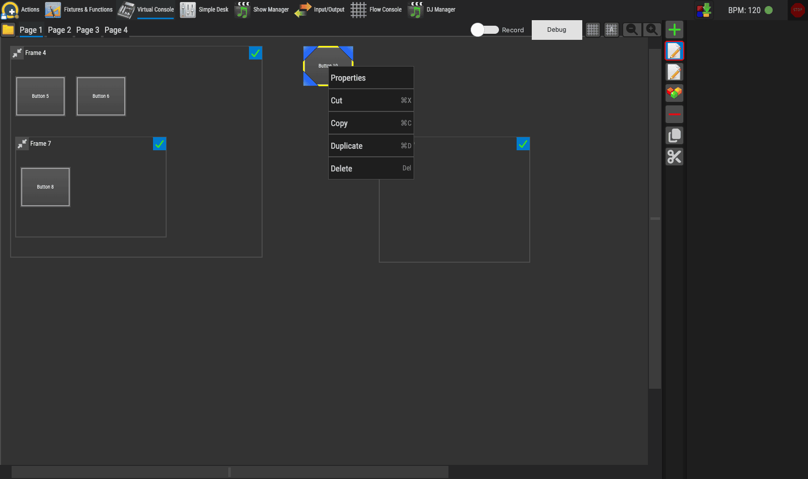</a> Properties</td><td align="center" valign="top"><a href="images/vc-editor/widgetmenu/cut-menu.png">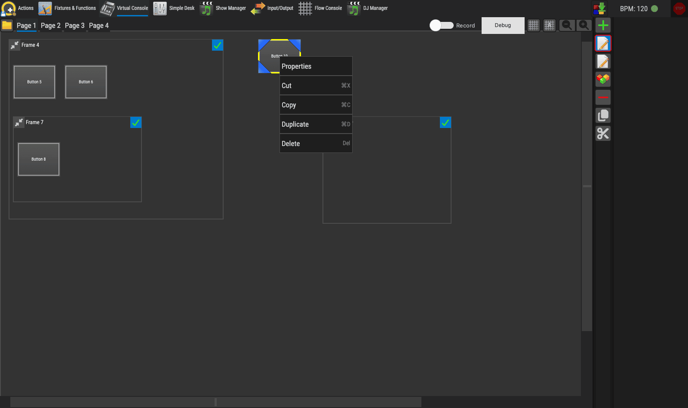</a> Cut</td><td align="center" valign="top"><a href="images/vc-editor/widgetmenu/copy-menu.png">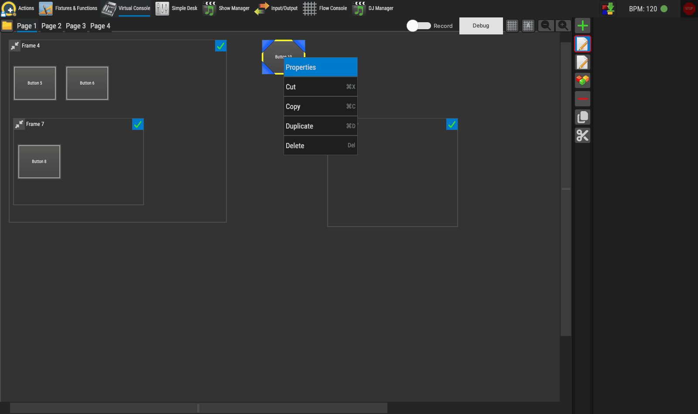</a> Copy</td></tr>
<tr><td align="center" valign="top"><a href="images/vc-editor/widgetmenu/duplicate-menu.png">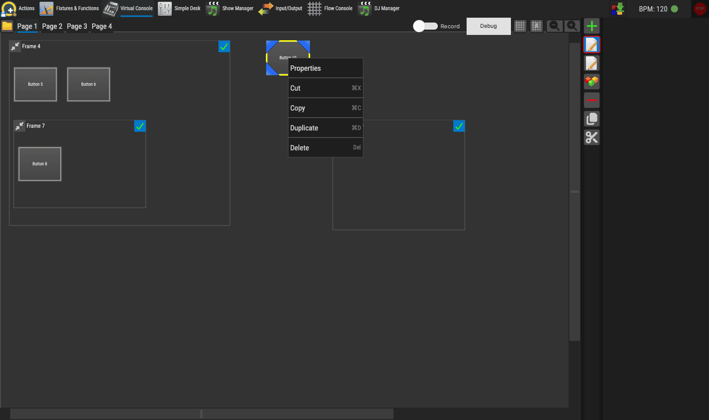</a> Duplicate</td><td align="center" valign="top"> Delete</td></tr>
</table>

## Click and Go box (`clickAndGoBoxShowsPick`)

A slider's Click and Go box shows the picked colour or preset.

<table>
<tr><td align="center" valign="top"><a href="images/vc-editor/clickandgoboxshowspick/colours-unpicked-cng-colours-unpicked.png">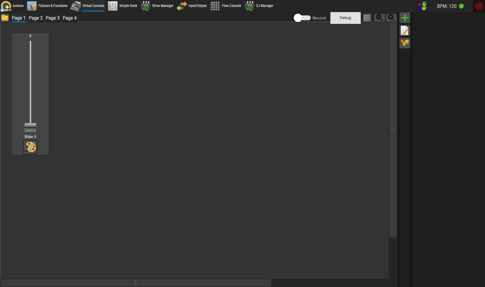</a> Colours, nothing picked</td><td align="center" valign="top"><a href="images/vc-editor/clickandgoboxshowspick/colours-red-cng-colours-red.png">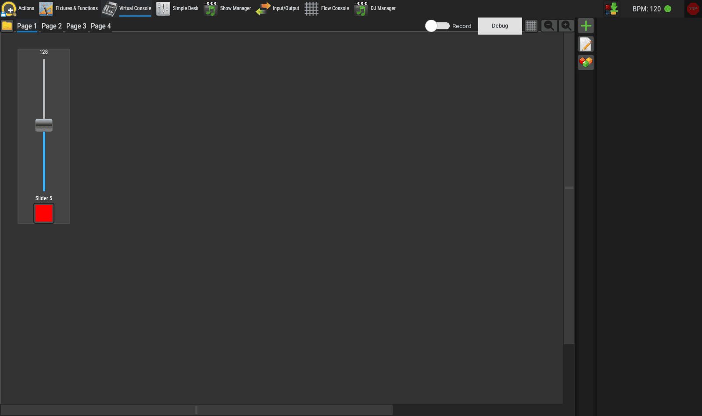</a> Colours, red picked</td></tr>
<tr><td align="center" valign="top"><a href="images/vc-editor/clickandgoboxshowspick/preset-unpicked-cng-preset-unpicked.png">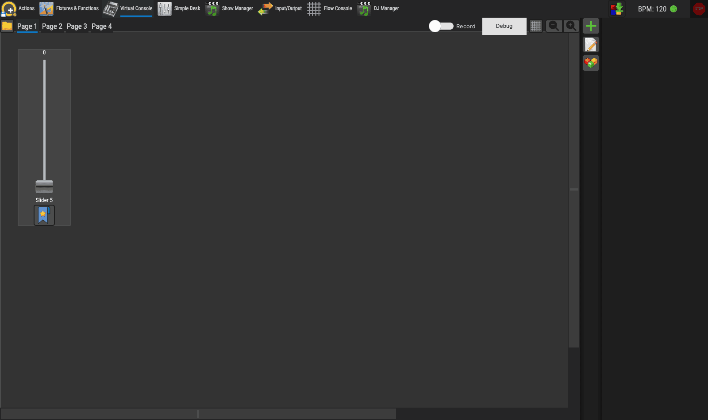</a> Preset, nothing picked</td><td align="center" valign="top"><a href="images/vc-editor/clickandgoboxshowspick/preset-red-cng-preset-red.png">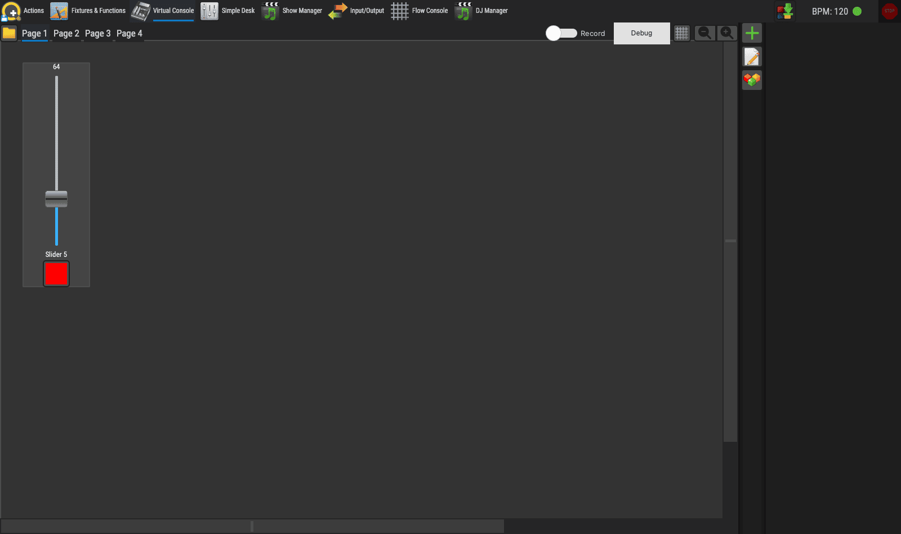</a> Preset, red picked</td></tr>
</table>

## Edit errors do not block (`editErrorsDoNotBlock`)

The reason for a refused edit shows in place, without a dialog, so shortcuts keep working. A warning about the selection is not a refused edit.

<table>
<tr><td align="center" valign="top"><a href="images/vc-editor/editerrorsdonotblock/console-message.png">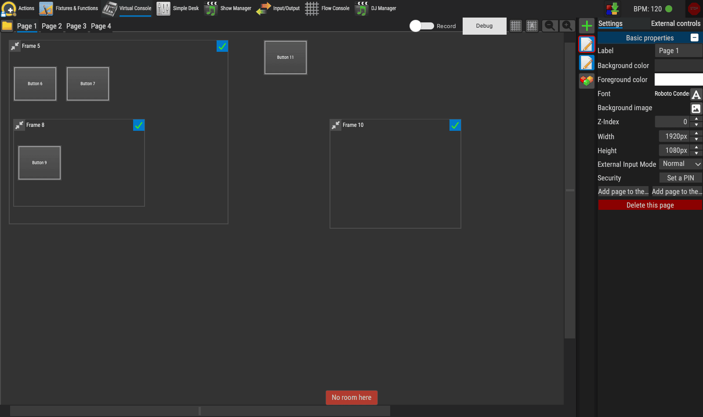</a> Refused console edit</td><td align="center" valign="top"> Refused widget edit</td><td align="center" valign="top"><a href="images/vc-editor/editerrorsdonotblock/warning-message.png">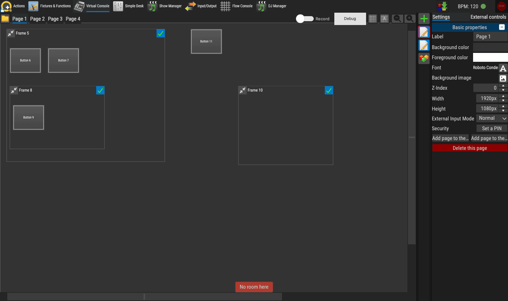</a> Selection warning</td></tr>
</table>

## Property panels (`multiSelectionPanel`, `arrangePanel`)

Side panels for a multi-selection and for arranging a frame.

<table>
<tr><td align="center" valign="top"><a href="images/vc-editor/multiselectionpanel/default-panel.png">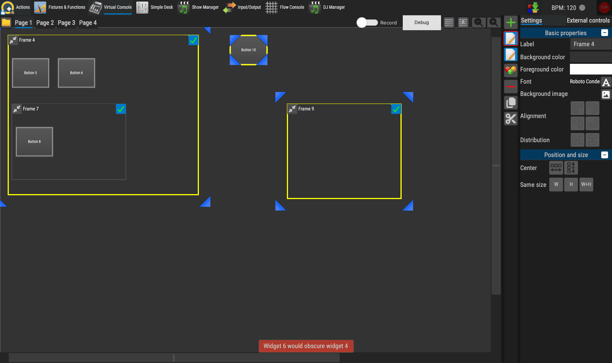</a> Three widgets selected</td><td align="center" valign="top"><a href="images/vc-editor/arrangepanel/default-arranged.png">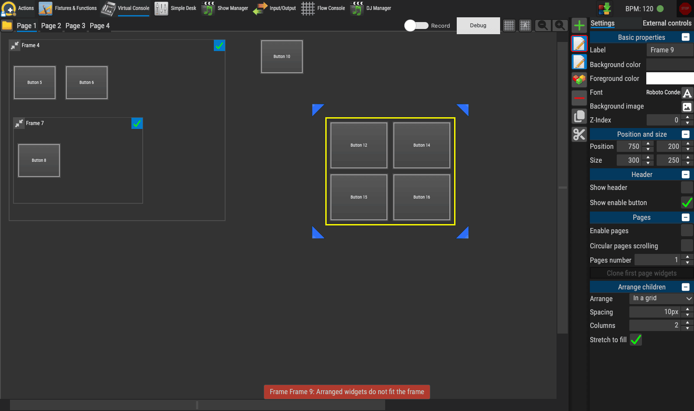</a> A frame arranged as a two-column grid</td></tr>
</table>
